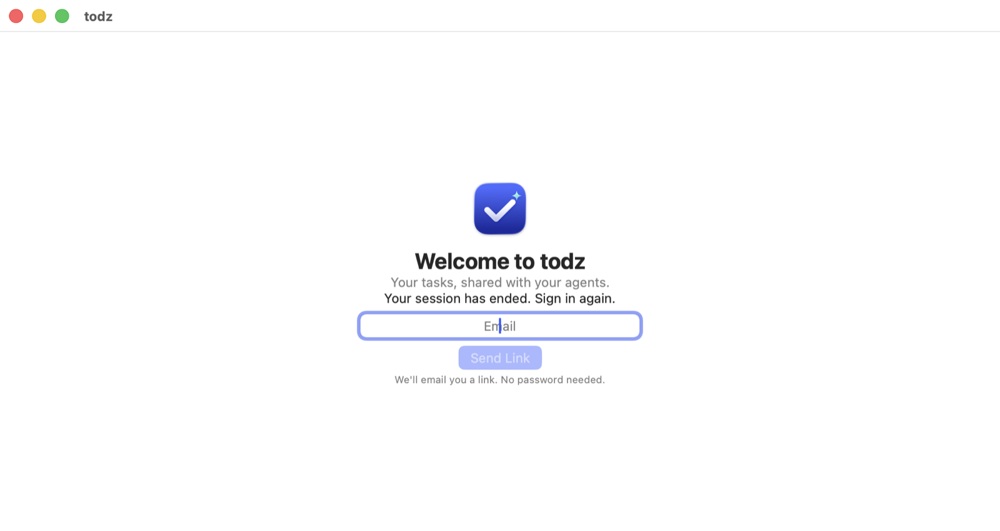
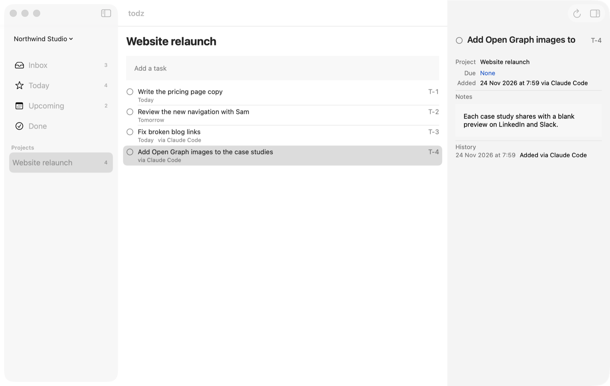
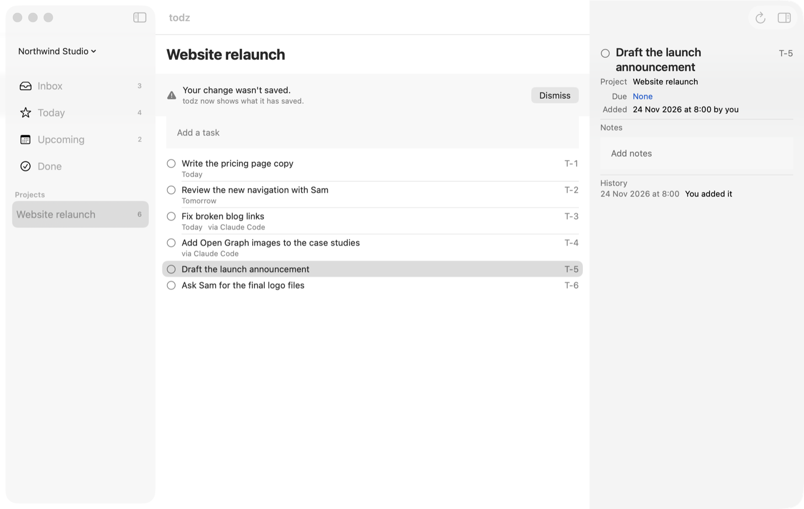
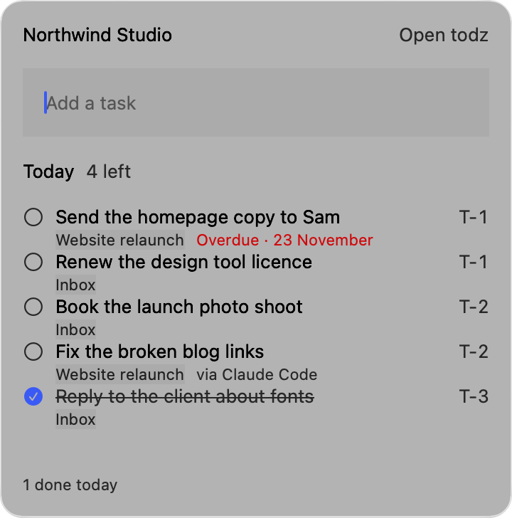
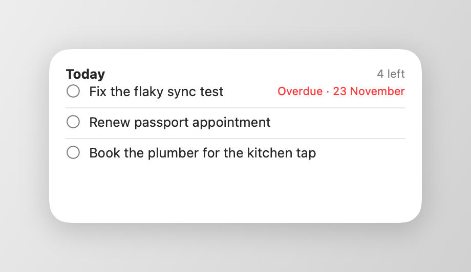
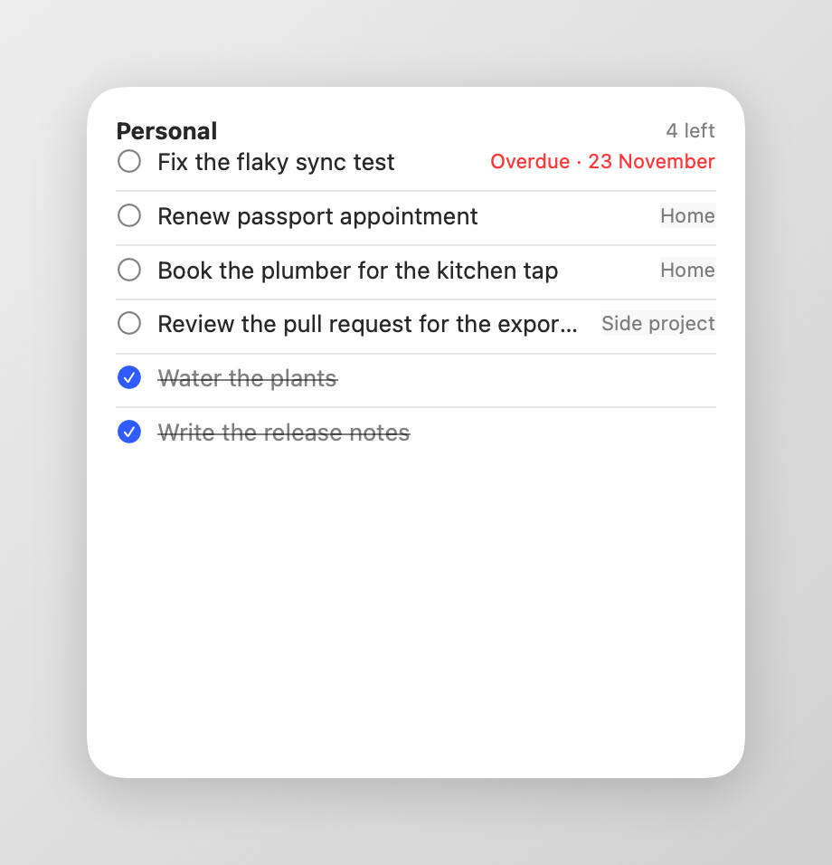

<h1 align="center">todz</h1>

  <strong>A to-do list that AI agents and their owner share.</strong>

  

---

todz is a to-do list that AI agents and their owner share. MCP-first and agentic-first: every action a person takes in the app, an agent can take through the MCP server (Claude Code, Codex, Cursor, any MCP client).

- **Multi-tenant.** Each workspace is isolated; projects live inside a workspace.
- **Cloud sync** across devices.
- **A native macOS app** with a menu bar extra and interactive WidgetKit widgets, simple and polished.
- **For AI enthusiasts and programmers.**

The approved design is in [docs/product](docs/product/); how each piece was built is in [docs/features](docs/features/) and the [ADRs](docs/adr/).

## A walk through todz

|                                                                                                                    |                                                                                                                       |
| ------------------------------------------------------------------------------------------------------------------ | --------------------------------------------------------------------------------------------------------------------- |
|  Sign in                                               |  Name your first workspace       |
|  Today across projects       |  An agent's task appears live       |
|  Offline, changes waiting |  A refused change, explained |
|  Today from the menu bar             |  Today ring widget                                        |
|  Next up widget                                             |  Medium Today list widget                        |
|  Large Today list widget                       |                                                                                                                       |

## How the work happens

One process for people and for coding agents alike, in [HARNESS.md](.claude/HARNESS.md); conventions and layout in [AGENTS.md](AGENTS.md).

## Community

- [Contributing](.github/CONTRIBUTING.md)
- [Security policy](.github/SECURITY.md)
- [Code of conduct](.github/CODE_OF_CONDUCT.md)

## License

[AGPL-3.0](LICENSE). Contributions come under the [Contributor License Agreement](.github/CLA.md).
