

  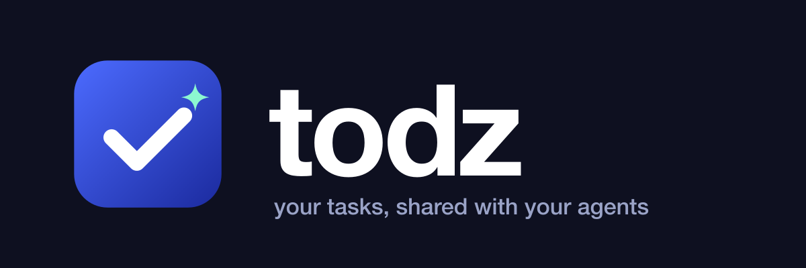

  <strong>A to-do list that AI agents and their owner share.</strong>

  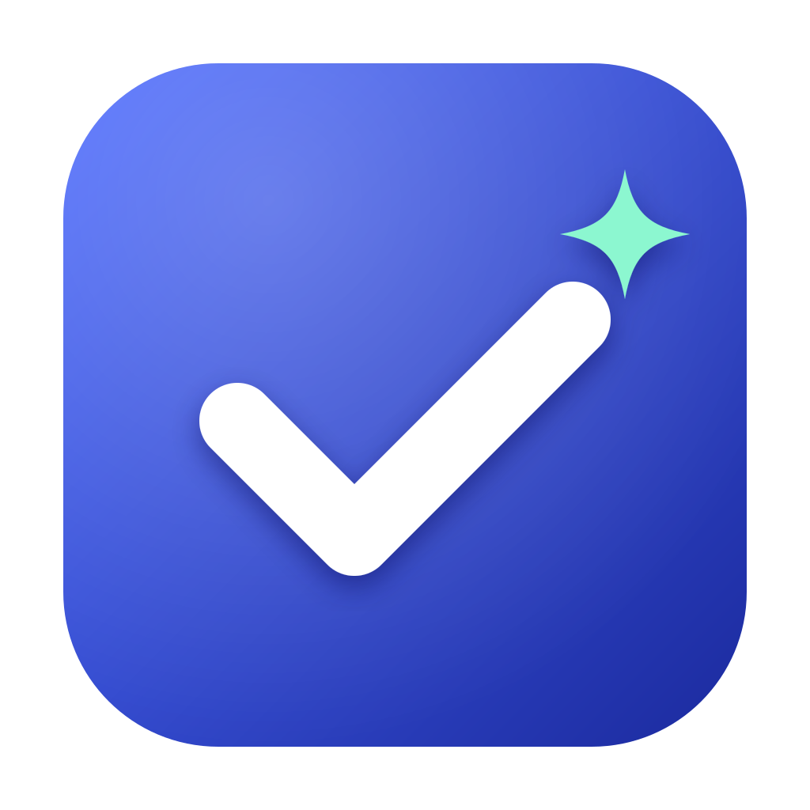

  

---

todz is a product of Logic Bit, made in Brazil: [logicbit.com.br](https://logicbit.com.br)

todz is a to-do list that AI agents and their owner share. MCP-first and agentic-first: every action a person takes in the app, an agent can take through the MCP server (Claude Code, Codex, Cursor, any MCP client).

- **Multi-tenant.** Each workspace is isolated; projects live inside a workspace.
- **Cloud sync** across devices.
- **A native macOS app** with a menu bar extra and interactive WidgetKit widgets, simple and polished.
- **For AI enthusiasts and programmers.**

The approved design is in [docs/product](docs/product/); how each piece was built is in [docs/features](docs/features/) and the [ADRs](docs/adr/). To run your own server, read [Self-host todz](docs/self-host.md).

## A walk through todz

| | |
| --- | --- |
| 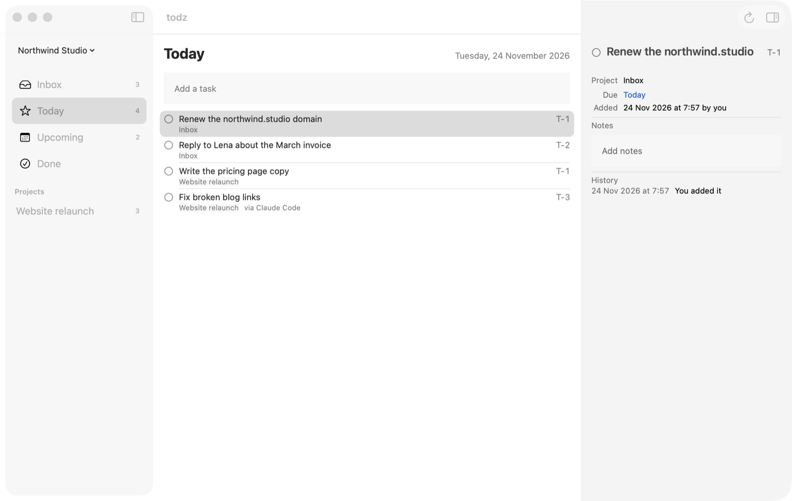 Today across projects |  An agent's task appears live |
|  Today from the menu bar |  Today's open tasks on the menu bar icon |
| 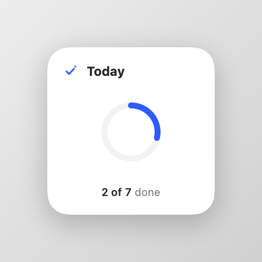 Today ring (rendered) | 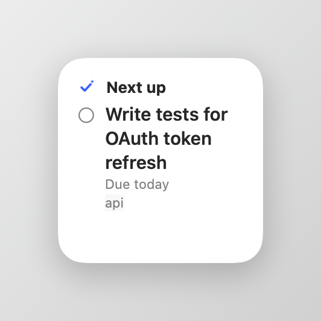 Next up (rendered) |
|  Medium Today list (rendered) |  Large Today list (rendered) |
|  Connect an agent | 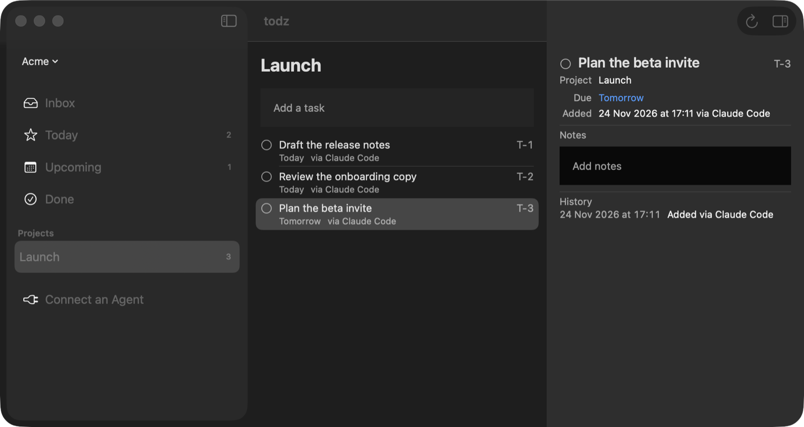 An agent's tasks in a project, via Claude Code |
| 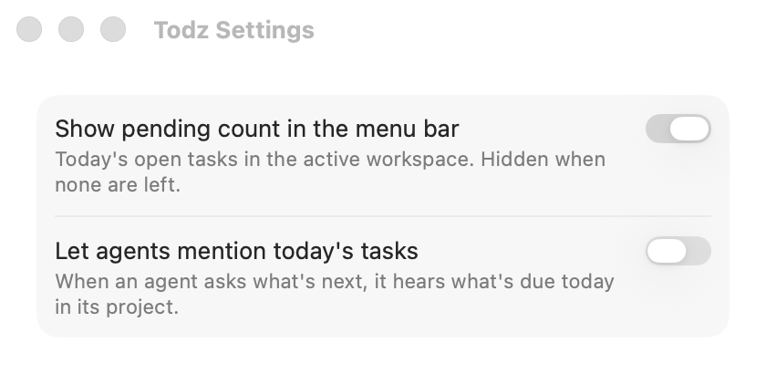 Let agents mention today's tasks | 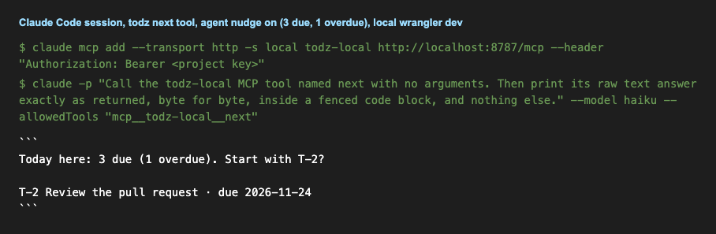 An agent's `next` opens with what is due today |
| 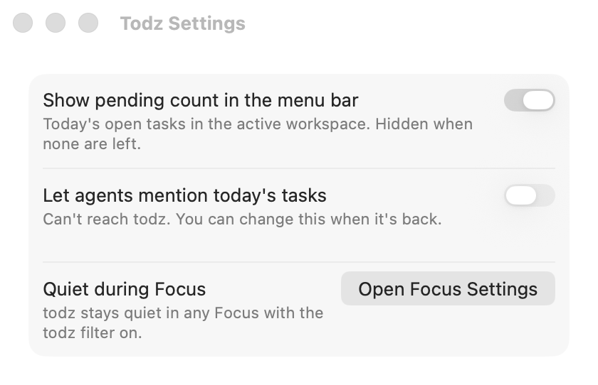 Quiet during Focus, in Settings | 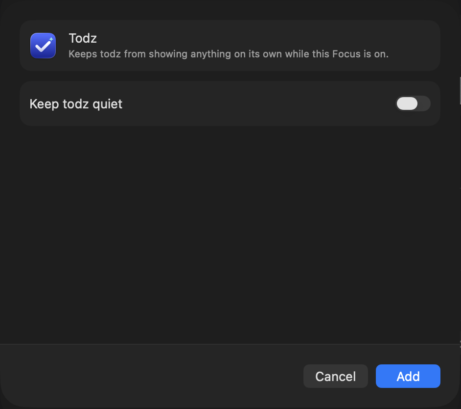 The todz Focus filter, added to any Focus mode |
| 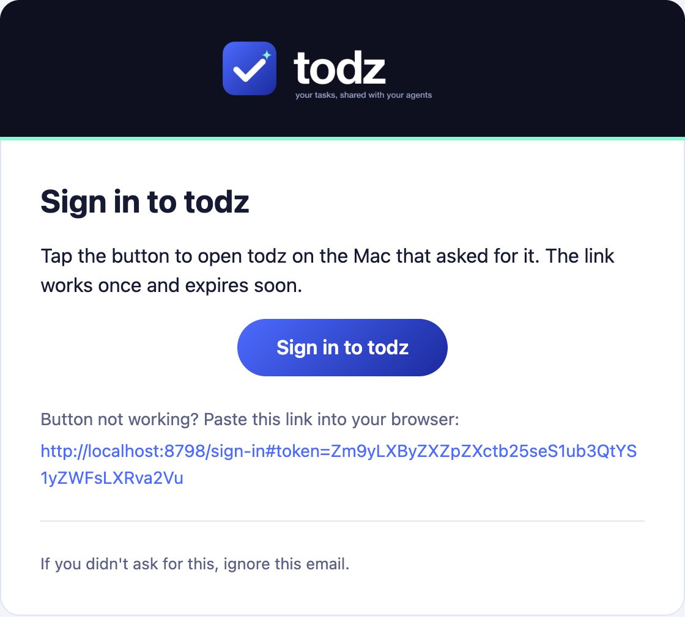 The sign-in mail | 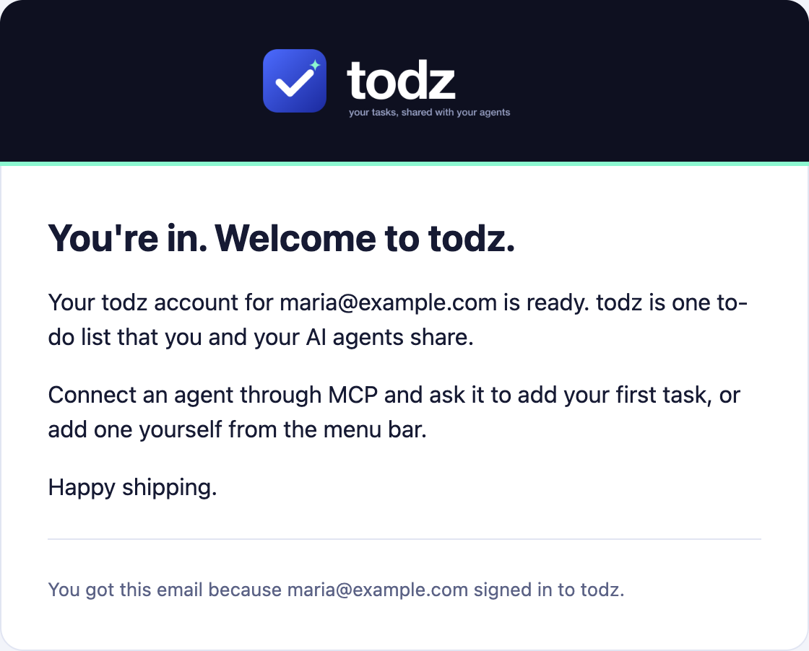 The welcome mail |
| 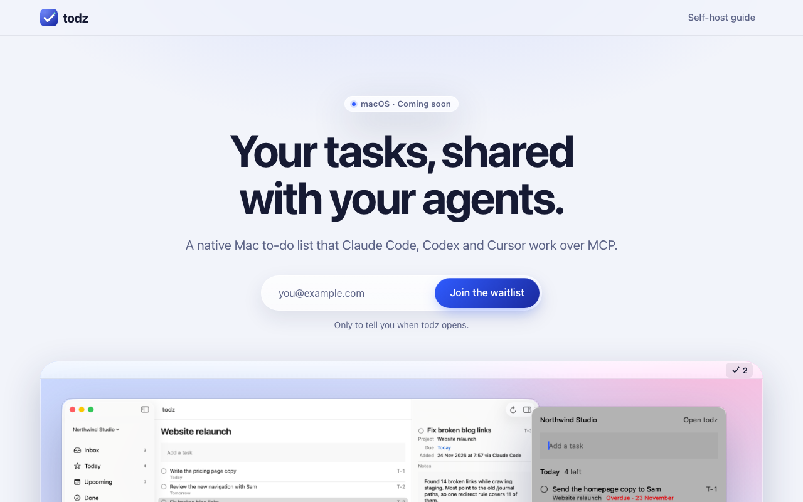 todz.app, the landing | 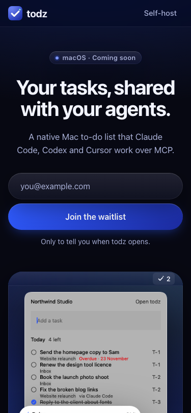 todz.app on a phone, in dark |

The widget shots are rendered from the widgets' own views until a desktop capture replaces them.

## How the work happens

One process for people and for coding agents alike, in [HARNESS.md](.claude/HARNESS.md); conventions and layout in [AGENTS.md](AGENTS.md).

## Community

- [Contributing](.github/CONTRIBUTING.md)
- [Security policy](.github/SECURITY.md)
- [Code of conduct](.github/CODE_OF_CONDUCT.md)

## License

[AGPL-3.0](LICENSE). Contributions come under the [Contributor License Agreement](.github/CLA.md).
