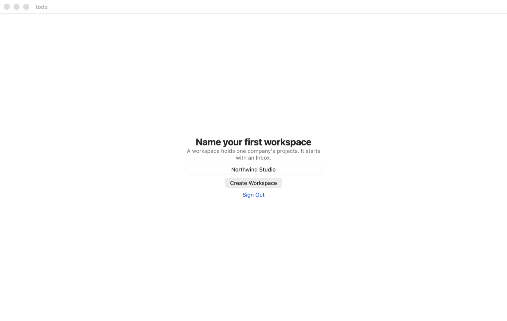
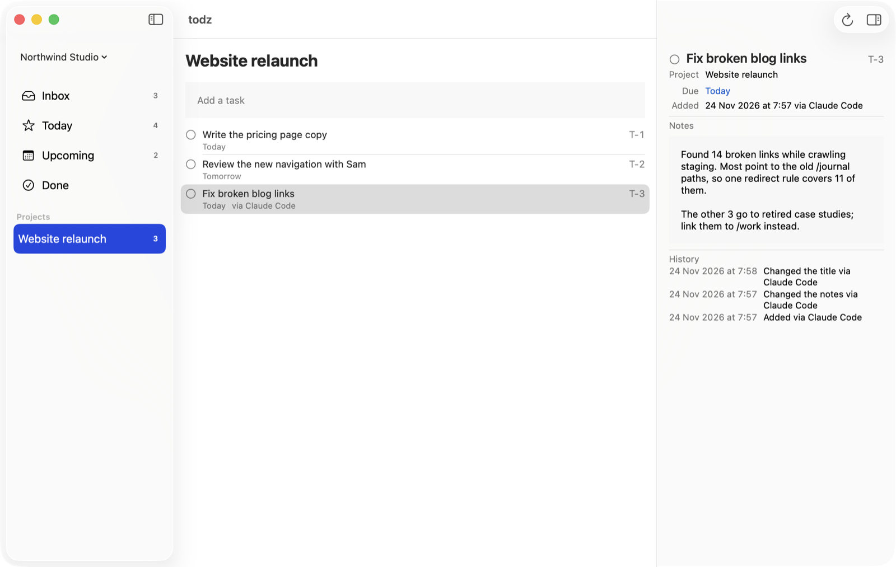
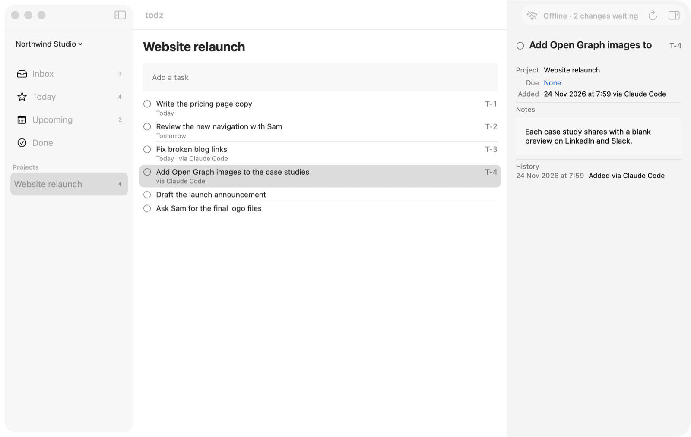

<h1 align="center">todz</h1>

  <strong>A to-do list that AI agents and their owner share.</strong>

---

todz is a to-do list that AI agents and their owner share. MCP-first and agentic-first: every action a person takes in the app, an agent can take through the MCP server (Claude Code, Codex, Cursor, any MCP client).

- **Multi-tenant.** Each workspace is isolated; projects live inside a workspace.
- **Cloud sync** across devices.
- **A native macOS app** with a menu bar extra and interactive WidgetKit widgets, simple and polished.
- **For AI enthusiasts and programmers.**

The approved design is in [docs/product](docs/product/); how each piece was built is in [docs/features](docs/features/) and the [ADRs](docs/adr/).

## A walk through todz

The native macOS app, screen by screen, as it is built today.

### The main window

Signing in with the development identity.

Naming the first workspace.

Today across the Inbox and a project, with a task an agent added marked "via Claude Code".

The inspector showing a task's notes and history.

### Sync and offline

A task an agent adds appears in the window as it happens.

Offline, with changes waiting to sync and pending adds drawn with a dashed ring.

A change the server refused is explained in a banner.

## How the work happens

One process for people and for coding agents alike, in [HARNESS.md](.claude/HARNESS.md); conventions and layout in [AGENTS.md](AGENTS.md).

## Community

- [Contributing](.github/CONTRIBUTING.md)
- [Security policy](.github/SECURITY.md)
- [Code of conduct](.github/CODE_OF_CONDUCT.md)

## License

[AGPL-3.0](LICENSE). Contributions come under the [Contributor License Agreement](.github/CLA.md).
