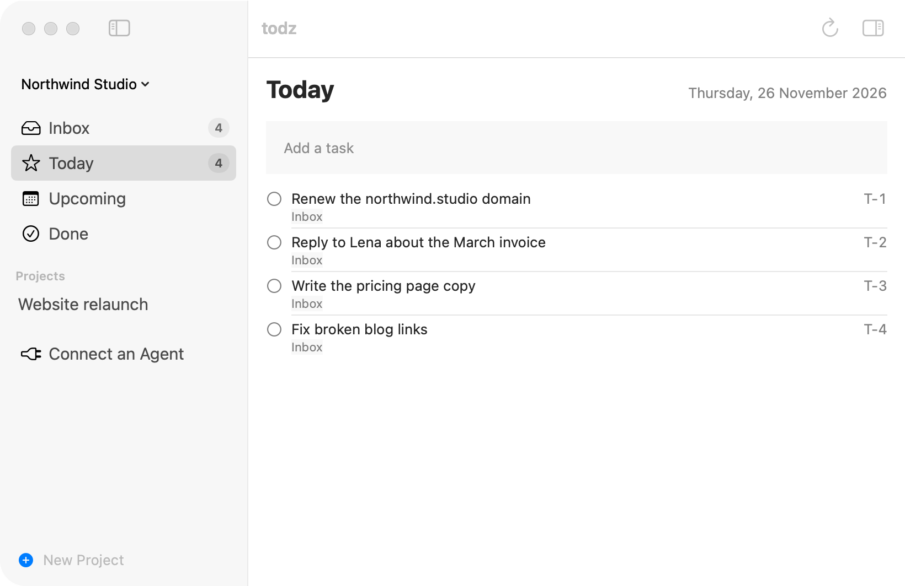
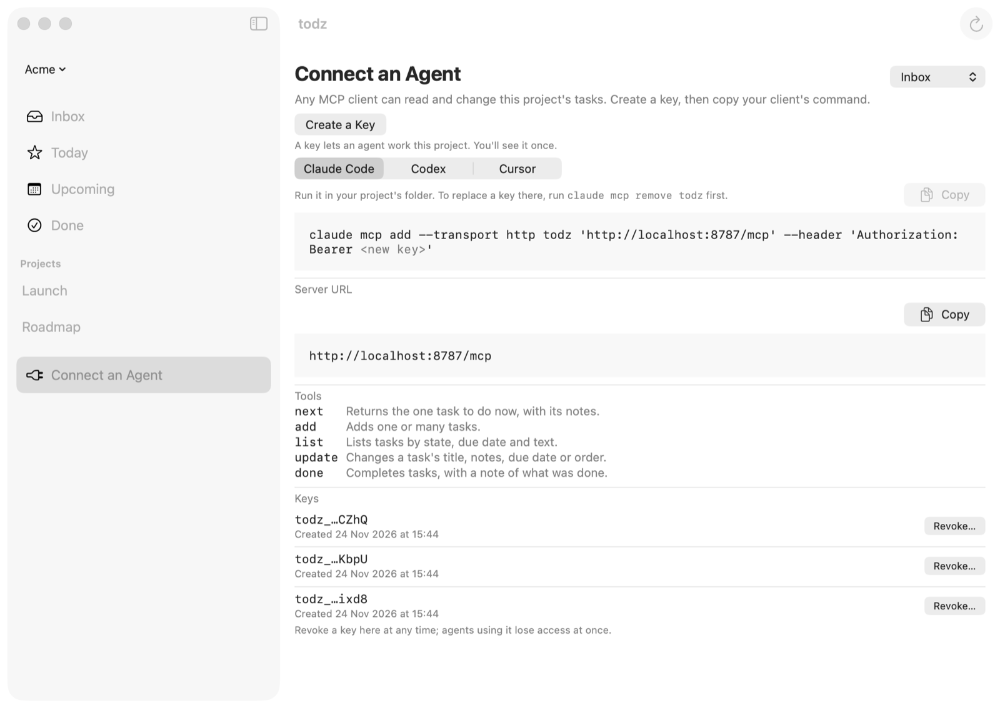

<p align="center">
  <a href="https://todz.app">
    <picture>
      <source media="(prefers-color-scheme: dark)" srcset="apps/docs/logo/dark.svg">
      
    </picture>
  </a>
</p>

<p align="center">
  <strong>Your to-do list, shared with your AI agents.</strong><br>
  Claude Code, Codex and Cursor add, plan and finish tasks in the same list you use on your Mac.
</p>

<p align="center">

[](LICENSE)
[](https://github.com/dhyegocalota/todz)
[](https://docs.todz.app)
[](https://todz.app/download)

</p>

<p align="center">
  
</p>

<p align="center">
  <sub>A task springs into Today, and one tick completes it.</sub>
</p>

| | |
| --- | --- |
| <br>**Today**, across every project. |  <br>**The menu bar** counts what is left; add a task without leaving your work. |
| <br>**Widgets** on your desktop; tick a task right there. | <br>**Connect an Agent**: one key, one `claude mcp add`. |

## Install

**[Download for Mac — Free](https://todz.app/download)** · or [run your own server](https://docs.todz.app/self-host).

## Connect an agent

1. Open todz and sign in with your email.
2. Open **Connect an Agent**, pick a project, and copy your client's command.
3. Paste it in your terminal, then ask your agent for the next task:

   ```bash
   claude mcp add --transport http todz 'https://api.todz.app/mcp' --header 'Authorization: Bearer <key>'
   ```

Codex, Cursor and every MCP tool: [docs.todz.app](https://docs.todz.app/connect-an-agent). More of the app: [a tour](https://docs.todz.app/tour).

## Contributing

Built by people and coding agents under one process: [HARNESS.md](.claude/HARNESS.md), [AGENTS.md](AGENTS.md).

[Contributing](.github/CONTRIBUTING.md) · [Security](.github/SECURITY.md) · [Code of conduct](.github/CODE_OF_CONDUCT.md)

## License

[AGPL-3.0](LICENSE). Contributions come under the [Contributor License Agreement](.github/CLA.md).

todz is a product of Logic Bit, made in Brazil: [logicbit.com.br](https://logicbit.com.br)
