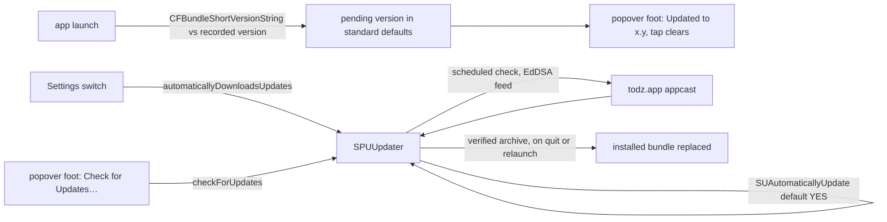

# Auto update

**Status:** Shipped 2026-11-26
**Tier:** 🔴 (the update channel, the release gate and the signing trust path; an installed copy replaces its own bundle)
**Owner approval:** approved 2026-11-26 by the owner's words in `todz-loop/PROMPT.md` "Tonight's last three", item 1: "auto update… pode desativar mas por padrão on.. não pode rely on na App Store", and "quero finalizar ainda hoje nas próximas horas", with "não faça verificações demais, só faz tudo logo, rápido com qualidade, pode merge e deploy".
**ADRs:** [0075](../../adr/0075-the-mac-app-updates-itself-by-default-through-sparkle-and-the-release-gate-is-a-local-check.md), [0072](../../adr/0072-the-mac-app-downloads-from-todz-app-as-a-development-signed-dmg-with-an-ssh-signature-and-updates-through-sparkle.md) (amended for the gate), [0068](../../adr/0068-one-respect-focus-switch-decides-for-every-proactive-surface-and-untouched-settings-follow-the-defaults.md), [0074](../../adr/0074-closing-the-window-keeps-todz-in-the-menu-bar-as-an-accessory-app-behind-a-setting-on-by-default.md)
**Not changing:** the feed, the EdDSA key, the appcast, the hosting, the signing identity, the release command's build and checks, the App Store (never), the Debug configuration's behaviour (no feed, no updater), the menu bar count, the sign-in.

## Problem

Sparkle is in the Release app and checks the appcast daily, but it only offers an update the owner has to accept. The owner wants installed copies to update themselves by default, with a switch to turn it off, and a way to check now from the popover. The first public release also waits for a check on the owner's other notebook, which keeps it off tonight.

## Goals

1. A Settings switch, "Update todz automatically", on by default for a Mac whose owner never touched it. On: Sparkle downloads and installs in the background, on quit or relaunch. Off: Sparkle still checks and offers.
2. "Check for Updates…" in the popover's foot, beside "Quit todz", in Release only.
3. A quiet "Updated to x.y" note in the popover's foot after an update, until the owner taps it. Nothing on the first launch.
4. `pnpm release:mac` and the `deploy` skill ship version x and then x+1 without a manual edit, and the first public release's gate is a local check on this Mac (the runbook's steps 8, 9 and 10).

## Non-goals

- The App Store, notarization, Developer ID, release notes, delta updates, beta channels, rollbacks.
- A custom updater: Sparkle downloads, verifies and replaces.
- A change to the release command's build, signing or production checks.
- A window that appears over another app: installs stay silent.

## Design

### Data flow

### Interfaces

- `UpdateNote` (TodzKit): `pendingVersion(recorded:current:)` returns `current` when a version was recorded and differs, else nil; the storage keys are constants there.
- `AppUpdater` (Release only, optional): `automaticallyUpdates` (stored, observable) with `setAutomaticallyUpdates(_:)`, which writes Sparkle's `automaticallyDownloadsUpdates`; `updatedToVersion` read from the standard defaults at init and cleared by `acknowledgeUpdate()`; `checkForUpdates()` and `canCheckForUpdates` as before.
- Environment: `\.appUpdater` (`AppUpdaterKey`), set to the app delegate's updater on the menu bar content and on the Settings scene. Nil in Debug.
- Settings: one switch, shown only when the environment holds an updater.
- Popover foot: "Check for Updates…" when the updater is present; the note when `UpdateNote` has a pending version.
- Info.plist and `project.yml`: `SUAutomaticallyUpdate` `YES`.

### Failure handling

- A background install that fails: Sparkle reports it and the installed version keeps running; the next check tries again.
- A feed or archive that does not verify: refused by Sparkle, as ADR 0072 decision 2 already states.
- A recorded version that is missing (the first launch, or the defaults were wiped): no note.
- The switch when no updater exists (Debug): not shown; no state is written.
- The note when the owner taps it: cleared, and not shown again until the next version change.

## Open questions → answers

| Question | Options | Owner's answer | Date |
|----------|---------|----------------|------|
| Default on or off? | on / off | on, "pode desativar mas por padrão on" | 2026-11-26 |
| Install when? | on download / on quit or relaunch / prompt | on quit or relaunch (PROMPT.md item 1) | 2026-11-26 |
| Where does "Check for Updates…" go? | popover menu / Settings | the popover's menu, as PROMPT.md item 1 says | 2026-11-26 |
| Other-notebook gate tonight? | keep / replace by a local check | replace: "Replace the other-notebook check gate with a local check on this Mac" (lead's instruction); ADR 0075 decision 5 | 2026-11-26 |

## Test strategy summary

Red-first unit tests of `UpdateNote` in TodzKit; a repository-shape test that `SUAutomaticallyUpdate` is `YES` in `project.yml` and the generated Info.plist; the install docs page and the runbook's new steps pinned by the docs tests; `pnpm verify`'s macOS gate for the app build. The user-visible walk (the switch, the entry, the note) is the tester's, from `tester-briefing.md`, on a local `wrangler dev` build of the Release app.
