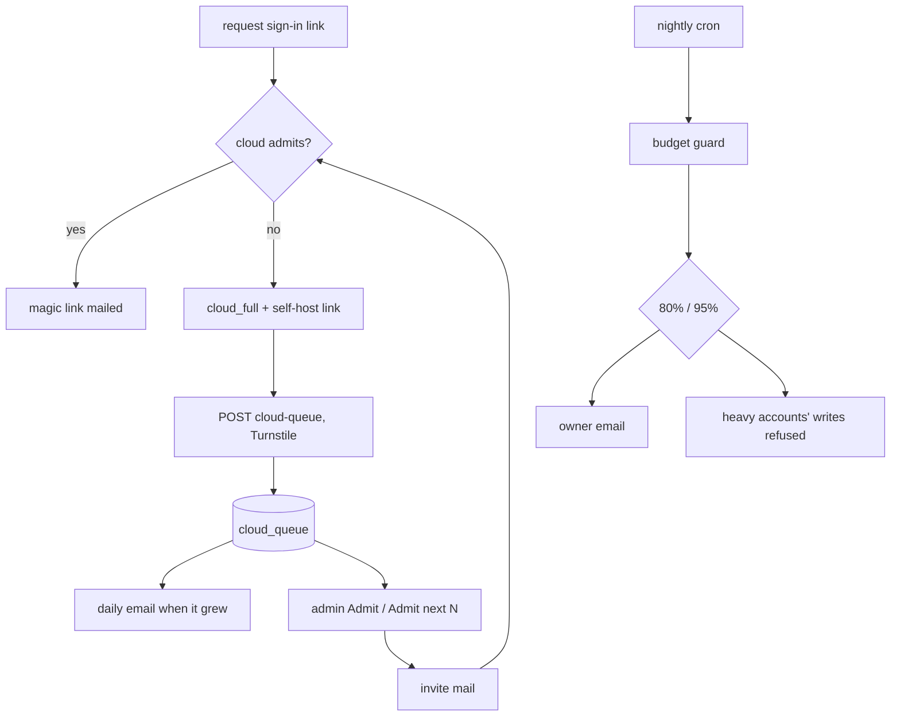

# Cloud capacity

**Status:** Building
**Tier:** 🔴
**Owner approval:** approved 2026-11-26 by the owner's words to the loop ("limita a quantidade de usuários pra eu não ter que pagar nada a mais nos bills; daí usuários a mais vão pra uma lista ou me avisa; mas não quero pagar mais que $5")
**ADRs:** [0099](../../adr/0099-the-todz-cloud-admits-at-most-thirteen-active-accounts-and-a-monthly-budget-guard-stops-heavy-writes-before-any-included-quota-runs-out.md)
**Not changing:** the fair-use limits, the sign-in flow for admitted accounts, self-hosted servers (the cap is off unless `CLOUD_ACCOUNTS_MAX` is set)

## Problem

The todz cloud must not cost more than the Workers Paid base of USD 5 a month, and nothing bounds how many accounts share the included quotas.

## Goals

- `CLOUD_ACCOUNTS_MAX` caps active accounts; above it a new address is not given a link and may join a queue.
- A nightly budget guard emails the owner at 80% of a metered dimension and refuses new writes from the heaviest accounts at 95%.
- The owner gets one email a day when the queue grew, and an admin page admits one address or the next N.
- Accounts idle for 90 days free their spot.

## Non-goals

- A client screen for the queue (server first), paid plans, per-read metering.

## Design

### Data flow

### Interfaces

`CLOUD_ACCOUNTS_MAX` var; `POST /owner/cloud-queue`; `GET /admin/cloud-queue`; `POST /admin/cloud-queue/admissions`; error code `cloud_full`; write refusal `cloud_at_capacity`.

### Failure handling

A malformed `CLOUD_ACCOUNTS_MAX` stops the Worker with an error, like the fair-use vars. A failed owner email never blocks the cron's other work.

## Open questions → answers

| Question | Options | Owner's answer | Date |
|----------|---------|----------------|------|
| The cap number | any | the loop sized it: 13 (ADR 0099) | 2026-11-26 |

## Test strategy summary

Vitest in `apps/api/test`: the cap, the queue, admit, the guard thresholds, the owner alert, the refusal copy.
