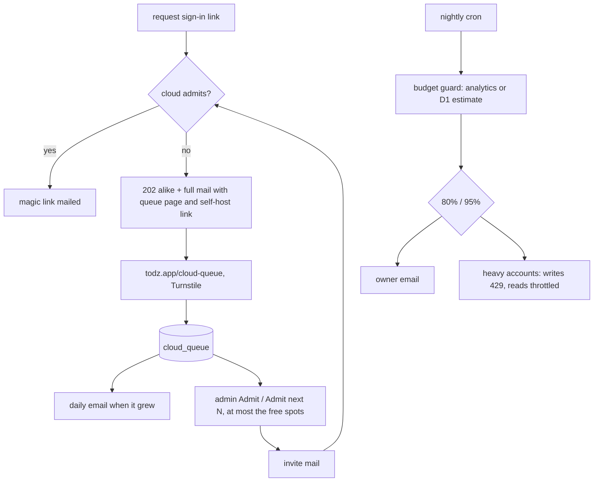

# Cloud capacity

**Status:** Shipped 2026-11-26
**Tier:** 🔴
**Owner approval:** approved 2026-11-26 by the owner's words to the loop ("limita a quantidade de usuários pra eu não ter que pagar nada a mais nos bills; daí usuários a mais vão pra uma lista ou me avisa; mas não quero pagar mais que $5") and his number ("50 contas e deixa claro que vagas free no cloud são extremamente limitadas")
**ADRs:** [0099](../../adr/0099-the-todz-cloud-admits-at-most-fifty-active-accounts-and-a-monthly-budget-guard-stops-heavy-writes-before-any-included-quota-runs-out.md)
**Not changing:** the fair-use limits, the sign-in flow for admitted accounts, self-hosted servers (the cap, the guard and the mail meter are off unless `CLOUD_ACCOUNTS_MAX` is set)

## Problem

The todz cloud must not cost more than the Workers Paid base of USD 5 a month, and nothing bounds how many accounts share the included quotas.

## Goals

- `CLOUD_ACCOUNTS_MAX` (50 on the todz cloud) caps active accounts; above it a new address is not given a link, gets a "full" mail instead, and may join a queue from `todz.app/cloud-queue`.
- A sign-in link request answers the same for an address that may sign in and one that may not.
- A nightly budget guard reads the month's real totals from Cloudflare's analytics when the optional `CLOUDFLARE_ANALYTICS_TOKEN` secret is set, estimates them from D1 when not, emails the owner at 80% and, at 95%, refuses new writes from the heaviest accounts (HTTP 429 `limit_reached` with `limit: "cloud_capacity"` with `Retry-After` to the first of next month) and throttles their reads.
- Every mail is metered; link mail is bounded per address per day.
- The owner gets one email a day when the queue grew, and an admin page admits one address or the next N, at most the free spots.
- Accounts idle for 90 days (no session, write, signed-in or agent-key request) free their spot, and an admission nobody redeems lapses after seven days. Admissions reserve their spots against strangers.
- A refused address gets a signed, expiring link to the queue page; only its holder can join the line, so a typed address never does.
- Any failure of the analytics falls back to the estimate, is recorded, mailed and shown on the admin page. Durable Object duration is a guarded dimension at an assumed GB-s per request.
- The landing, the docs, `llms.txt` and the mails say that free todz cloud spots are extremely limited and that self-hosting is always open.

## Non-goals

- A client screen for the queue and for the capacity message (the Mac app's own lane), paid plans, per-account read metering, bounding stored text of idle accounts.

## Design

### Data flow

### Interfaces

`CLOUD_ACCOUNTS_MAX` and `CLOUDFLARE_ACCOUNT_ID` vars; `CLOUDFLARE_ANALYTICS_TOKEN` optional secret; `CLOUD_READ_LIMITER` binding; `GET` and `POST /cloud-queue` on the site host, reached by the signed link in the full mail; `GET /admin/cloud-queue`; `POST /admin/cloud-queue/admissions`; error code `cloud_full` (sign-in itself only); `429 limit_reached` (`limit: "cloud_capacity"`).

### Failure handling

A malformed `CLOUD_ACCOUNTS_MAX` stops the Worker with an error, like the fair-use vars. A failed owner email never blocks the cron's other work and is not stamped as sent. A failing analytics call fails the nightly run and the previous level stands.

## Open questions → answers

| Question | Options | Owner's answer | Date |
|----------|---------|----------------|------|
| The cap number | any | 50, with the 95% guard carrying the USD 5 rule (ADR 0099) | 2026-11-26 |

## Test strategy summary

Vitest in `apps/api/test`: the cap and its conditional insert, the alike answer and the full mail, the queue page and its policy, admit and its free-spot limit, lapse, the mail meter and its daily bound, the guard thresholds from the analytics and from the estimate, the owner alert, the 429 refusal and its `Retry-After`, the read throttle, the admin exemption.
