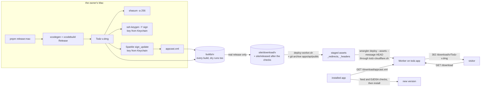

# Mac distribution

**Status:** Shipped 2026-11-25
**Tier:** 🔴 (signing, a public binary in the production Worker's assets, every deploy's staging, an update channel, private keys)
**Owner approval:** approved 2026-11-25 by the owner's words in `todz-loop/PROMPT.md`, "Installing the Mac app without the App Store": "ou então tem como gerarmos e deixarmos disponível pra download? de forma segura e verificada é claro", then, overriding the notarization gate, "vamos sem notarizar", and for the automation "faz uma automação pra gerar esse DMG". The shape is the loop's call in [ADR 0072](../../adr/0072-the-mac-app-downloads-from-todz-app-as-a-development-signed-dmg-with-an-ssh-signature-and-updates-through-sparkle.md).
**ADRs:** [0072](../../adr/0072-the-mac-app-downloads-from-todz-app-as-a-development-signed-dmg-with-an-ssh-signature-and-updates-through-sparkle.md) (amended 2026-11-25: the files are Worker assets, not R2), [0035](../../adr/0035-with-the-personal-team-the-widgets-share-the-app-group.md), [0033](../../adr/0033-without-a-team-the-widgets-share-a-folder-in-application-support-that-an-app-group-replaces-later.md), [0049](../../adr/0049-todz-app-is-served-by-the-same-worker-dispatched-by-host-in-three-features.md), [0044](../../adr/0044-the-wrangler-configuration-is-production-on-api-todz-app-and-development-overrides-it.md)
**Not changing:** the bundle identifiers, the App Group, the URL schemes, the waitlist and its copy, the sign-in, the API host, the Debug configuration's behaviour (its shared entitlements gain Sparkle's two mach-lookup names, which nothing in Debug looks up). No notarization, no Developer ID, no GitHub Actions release.

## Problem

There is no App Store listing and no download. The only way to run todz is to build it from source, which the "Install on Mac" page (`mac-install-docs`) explains. The landing says "Coming soon". A person who wants todz cannot get it, and once installed there is no way to receive a fix.

## Goals

1. A public download at `https://todz.app/download`: a DMG built from a tagged commit on `main`, signed with the team's Apple Development identity (Team ID `XFWR794VS8`) and the hardened runtime, without `get-task-allow`.
2. Every release carries a SHA-256 sum and a detached signature from a todz release key, verifiable with tools every Mac ships. The public key is in the repository and on the "Install on Mac" docs page.
3. The files are the Worker's own static assets on `todz.app`, staged at deploy time from a release folder outside git, with no new permission: `/download` and `/download/latest` redirect to the versioned DMG, served with `Content-Disposition: attachment` and immutable caching, beside its sum and signature and the appcast. R2 is the documented fallback for a DMG over 25 MiB.
4. Installed copies update through Sparkle 2 from an EdDSA-signed appcast at `https://todz.app/download/appcast.xml` (the feed and its enclosure both signed, both required), so an update is trusted after the first install without notarization. A scheduled check never brings a window over another app.
5. The landing's hero shows a "Download for Mac" button and one honest line, "Not notarized by Apple yet: the first time, open it from System Settings › Privacy & Security.", linking the "Install on Mac" page. The eyebrow stops saying "Coming soon".
6. One command, `pnpm release:mac`, does a release end to end, refuses anything but a clean `main`, is idempotent per version, never overwrites a published file, has `--dry-run`, and a test of its refusals.
7. Notarization (Developer ID, `notarytool`, stapling) is scripted and documented, switched off.
8. A repository skill `deploy` (owner: "já gera e atualiza o site de forma segura; pode ser comando e skill automático do agent na hora do deploy") is the one way any agent deploys: it runs `docs/runbooks/deploy-the-api.md`, then `pnpm release:mac` when `apps/macos` changed since the highest `mac-v*` tag, then checks production (the download answers, the sum matches, the signature verifies with the public key, the appcast lists the new version), stops at the first failure and leaves the previous release live.
9. The release key and Sparkle's EdDSA key live only in the login Keychain, never in the repository, a log, or a file on disk, except the private key file `ssh-keygen` writes inside `~/.todz-release` (mode `700`) while `--create-release-key` runs, deleted before it returns. The keys are protected by the owner's macOS session, not from processes running in it; the secrets guard hook refuses an agent command that reads either one outside the release command.
10. The docs page states the trust limit honestly and publishes the release key's fingerprint and Team ID; the owner publishes the fingerprint outside the `todz.app` zone through his GitHub account.

## Non-goals

- Notarization, Developer ID, the Mac App Store, Homebrew casks.
- A GitHub Actions release on tag (ADR 0072 → Alternatives).
- Delta updates, release notes pages, beta channels, rollbacks through the appcast.
- An HTML download page: `/download` is a redirect.
- Byte-range requests, download counts or analytics.
- Changing the waitlist: it stays as `waitlist-inline` ships it.
- The ad hoc fallback build: it is decided (ADR 0072 → Decision 1), not built, unless the other-Mac check fails.

## Design

### Data flow

`~/.todz-release/` (mode `700`, outside git):

| Path | Holds | Written |
|---|---|---|
| `builds/<version>/` | `Todz-<version>.dmg`, `.sha256`, `.sig`, the signed `appcast.xml`, `commit` (the commit built) | by every build, dry runs included; a complete set for `HEAD` is never rebuilt |
| `site/download/<version>/` | the same four files | copied from `builds/` by a real release; removed again if its production checks fail |
| `site/released` | one version per line | appended only after a release's production checks pass |
| `packages/` | the resolved Swift packages | — |

A deploy serves the latest two versions in `released`; anything older answers `404`.

### Interfaces

**Served on the Worker's assets** (every host the Worker serves; the landing and the appcast name only `todz.app`):

| Path | Answer | From |
|---|---|---|
| `/download`, `/download/latest` | `302` to `/download/<newest>/Todz-<newest>.dmg`, carrying at least `Location` (whether `_headers` adds its rules to a `302` is recorded by plan step 4) | `_redirects` |
| `/download/<version>/Todz-<version>.dmg` | the file, `Content-Disposition: attachment; filename="Todz-<version>.dmg"`, `Cache-Control: public, max-age=31536000, immutable`, the assets' `ETag` | `_headers` |
| `/download/<version>/Todz-<version>.dmg.sha256` and `.sig` | the file, `Content-Type: text/plain; charset=utf-8`, the same immutable `Cache-Control` | `_headers` |
| `/download/appcast.xml` | the file, `Content-Type: application/xml; charset=utf-8`, `Cache-Control: public, max-age=300` | `_headers` |
| anything else under `/download/` (`/download/allowed-signers` included) | not a staged file, so the Worker answers the site's `404` | the file set |

Every `200` keeps `apps/api/public/_headers`' security headers. Before the first release `/download` is not in `_redirects` and answers `404`.

**Deploying the Worker:** `scripts/deploy-worker.sh [--stage-only <dir>]` is every deploy's one path (`deploy-the-api.md` step 8 and the release command). It fills a new empty directory under `~/.todz-deploy/` with `git archive HEAD apps/api/public` (never the working tree) and, from `site/`, the latest two versions in `released` (sorted numerically; each directory matching `^[0-9]{1,4}\.[0-9]{1,4}\.[0-9]{1,4}$`; only the three served names copied; each passing `shasum -a 256 -c` and `ssh-keygen -Y verify`; each equal to production's `.sha256` where production serves it), plus the newest released `appcast.xml`. It refuses a symlink, a stray entry, a foreign `_headers`, `_redirects` or `.assetsignore`, a file over 25 MiB, a production `/download/latest` naming a version not in `released`, and any production request failing other than with a `404`. It writes `_redirects` and one `_headers` rule per staged file, deploys with `wrangler deploy --assets <dir> --message <HEAD sha>` through the wrapper, and records the new version id in `~/.todz-deploy/deployments/<HEAD sha>`.

**The app:** Sparkle `2.10.1`, pinned by `revision: ab7d71291238df6e0492143b120c9b696a35f603`, in the `Todz` target only. Release's Info.plist carries `SUFeedURL` (`https://todz.app/download/appcast.xml`), `SUPublicEDKey`, `SUEnableInstallerLauncherService` (`YES`, the sandboxed installer), `SUEnableAutomaticChecks` (`YES`), `SUScheduledCheckInterval` (`86400`), `SURequireSignedFeed` (`YES`) and `SUVerifyUpdateBeforeExtraction` (`YES`); its entitlements add the two Sparkle mach-lookup exceptions (`$(PRODUCT_BUNDLE_IDENTIFIER)-spks`, `-spki`). Debug carries no feed, and with no feed the app starts no updater. Scheduled checks use Sparkle's gentle reminders: no window over another app, the update shown at the next launch or on "Check for Updates…", which the app menu gains under "About Todz" in Release. In both targets the Release configuration sets `ENABLE_HARDENED_RUNTIME: YES` and `CODE_SIGN_INJECT_BASE_ENTITLEMENTS: NO`; `base` keeps the runtime off.

**The release command:** `pnpm release:mac [--version <x.y.z>] [--dry-run] [--create-release-key]` runs `scripts/release-mac.sh`, with every external tool call bounded by a time limit that fails naming the step:

1. Refuses unless the tree is clean, the branch is `main`, `HEAD` equals `origin/main` after a fetch, the active deployment's message is `HEAD`'s sha (the runbook deployed this code), the resolved Sparkle checkout is at the pinned commit, and `todz-release-key` exists.
2. The version is the one whose `builds/<version>/commit` holds `HEAD`'s hash; otherwise the next patch after the highest `mac-v*` tag, or `--version` when greater. The build number is `git rev-list --count HEAD`, refused unless greater than production's appcast `sparkle:version`, or equal when that appcast's version is this version. Both reach `xcodebuild` as `MARKETING_VERSION` and `CURRENT_PROJECT_VERSION`; nothing is committed, and no tag is created yet.
3. A complete set in `builds/<version>/` is re-checked (sum, signature) and reused. Otherwise `xcodegen`, then `xcodebuild` Release. Refuses unless the app and `Contents/PlugIns/TodzWidgets.appex` both pass `codesign --verify --deep --strict`, carry `TeamIdentifier=XFWR794VS8` and `runtime`, hold no `get-task-allow`, no `com.apple.developer.` entitlement and no `embedded.provisionprofile`, and the built Info.plist's `SUFeedURL` and `SUPublicEDKey` equal the script's constant and `generate_keys -p`.
4. The DMG (`hdiutil`, the app plus an `Applications` link), signed with the same identity; the sum file (`shasum -a 256` format); the signature (`ssh-keygen -Y sign -n todz-release`, the key loaded from `todz-release-key` into the script's own agent, ADR 0072 decision 4), verified against `apps/macos/release/allowed-signers` before anything else; the appcast rendered with one item and no description or release-notes link, then signed by `sign_update` (enclosure and feed).
5. `--dry-run` stops here: it prints the build's path and sum, and never tags, writes `site/` or deploys. `<version>` in `released` with production serving the same sum → "already published", exit 0, pushing the tag only if `origin` lacks it; production serving another sum → refuse.
6. It records the active version id, copies the build into `site/download/<version>/`, runs `deploy-worker.sh`, and checks production: the `302` of `/download/latest`, the DMG's `200`, its sum, its signature, and the appcast's version and signature. Any failure → `wrangler rollback <the recorded version id>`, `site/download/<version>/` removed, `released` unchanged, exit 1.
7. Appends `<version>` to `released`, creates `mac-v<version>` on `HEAD` (refused when it exists on another commit), pushes it, and prints the download URL and the sum. Notarization (`notarytool submit --keychain-profile todz-notary --wait`, `stapler staple`) is a function behind a constant that is `false`.

`--create-release-key` makes the Ed25519 key inside `~/.todz-release`, stores it through `security -i` (unless `security add-generic-password -w` is proven to read standard input), deletes the file, and prints the allowed-signers line and its fingerprint.

### Failure handling

- **Gatekeeper rejects the app** (`spctl -a -vv` → `rejected`, `origin=Apple Development`): expected. The landing line and the docs page say how to open it once.
- **The build does not launch on a Mac outside the team's devices** (the owner's check on his other notebook, todz-6f): ADR 0072 → Decision 1's fallback; no release is published until that check passes.
- **An update's EdDSA signature or code signature does not match:** Sparkle refuses it and the installed version keeps running.
- **A deploy from a Mac without the release folder:** the staging refuses ("would remove the published download"); the live files stay as they are.
- **A DMG over 25 MiB:** the staging refuses and names it; ADR 0072's R2 fallback takes over by a superseding ADR.
- **A key missing from the Keychain:** the script stops before any deploy and names the item, never the value.
- **A half-finished release** (a crash after the build or the deploy): the build in `builds/<version>/` is reused for the same `HEAD`; a failed check has already rolled back to the recorded version id and left `released` unchanged, so the previous release stays live and the next deploy does not republish the failed one.
- **A dry run:** it never reaches `site/`, so no deploy can publish it.
- **A release folder lost:** the runbook's "Rebuild the release folder from production" restores it from the served files after their sums and signatures pass.
- **A Keychain prompt in an unattended run:** the time limit fails naming the step; runbook step 2 approves `sign_update` once.

## Open questions → answers

| Question | Options | Owner's answer | Date |
|----------|---------|----------------|------|
| Notarize? | notarize now / ship without | "vamos sem notarizar" | 2026-11-25 |
| Development-signed or ad hoc? | Apple Development / ad hoc | the loop's call, ADR 0072: Apple Development, ad hoc only if the other-Mac check fails | 2026-11-25 |
| Show the owner's Apple ID address in public builds? | accept / wait for Developer ID | the owner, relayed by todz-6f: accepted; keep the App Group and the Team ID check; Developer ID under Logic Bit later; publish only after the other-notebook check | 2026-11-25 |
| Which detached signature? | minisign / Sigstore / OpenSSL / SSH | the loop's call, ADR 0072: SSH signatures (`ssh-keygen -Y`), the one tool on every Mac that verifies Ed25519 | 2026-11-25 |
| Where do version bumps live? | a commit on `main` / the tag | the loop's call, ADR 0072: the tag, so no commit lands on `main` | 2026-11-25 |
| GitHub Actions release? | on tag / local | the owner: local, "stays off unless the owner asks" | 2026-11-25 |
| Where do the files live? | R2 / the Worker's assets | the loop's call on least privilege, ADR 0072 decision 5: assets, after the owner's session declined an account-wide R2 permission; R2 only past 25 MiB | 2026-11-25 |

## Test strategy summary

Red-first tests for the deploy script (the file set from `git archive` and `released`, `_redirects`, `_headers`, the refusals, the deployment message), the secrets guard's release-key rule, for the landing's button, line and eyebrow, and a Playwright E2E against a server on staged fixture assets (the redirects, the headers, an unknown path's `404`, the hero at 1280 and 375 in light and dark, a click that downloads); a shape test for the Release signing settings and the Sparkle keys in `project.yml`; a TodzKit test for the feed reading; `scripts/release-mac.test.sh` for every refusal, the dry run, idempotence and "never overwrite", with fake binaries; and the first real release, run by the runbook, as the end-to-end proof, with the other-Mac launch checked by the owner.
