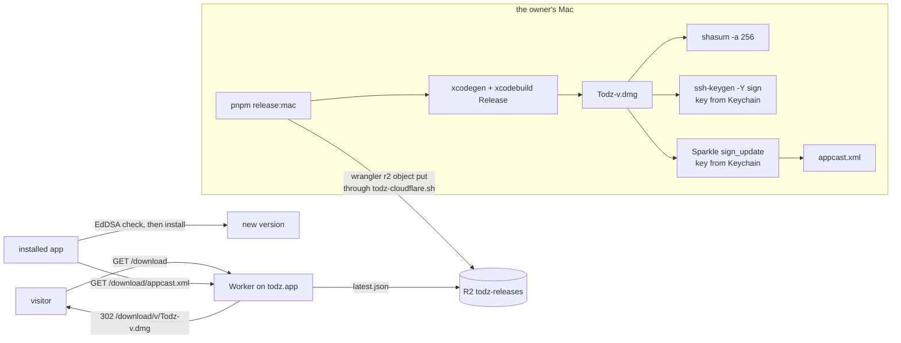

# Mac distribution

**Status:** Approved
**Tier:** 🔴 (signing, a public binary, an R2 bucket behind the production Worker, an update channel, private keys)
**Owner approval:** approved 2026-11-25 by the owner's words in `todz-loop/PROMPT.md`, "Installing the Mac app without the App Store": "ou então tem como gerarmos e deixarmos disponível pra download? de forma segura e verificada é claro", then, overriding the notarization gate, "vamos sem notarizar", and for the automation "faz uma automação pra gerar esse DMG". The shape is the loop's call in [ADR 0072](../../adr/0072-the-mac-app-downloads-from-todz-app-as-a-development-signed-dmg-with-an-ssh-signature-and-updates-through-sparkle.md).
**ADRs:** [0072](../../adr/0072-the-mac-app-downloads-from-todz-app-as-a-development-signed-dmg-with-an-ssh-signature-and-updates-through-sparkle.md), [0035](../../adr/0035-with-the-personal-team-the-widgets-share-the-app-group.md), [0033](../../adr/0033-without-a-team-the-widgets-share-a-folder-in-application-support-that-an-app-group-replaces-later.md), [0049](../../adr/0049-todz-app-is-served-by-the-same-worker-dispatched-by-host-in-three-features.md), [0044](../../adr/0044-the-wrangler-configuration-is-production-on-api-todz-app-and-development-overrides-it.md)
**Not changing:** the bundle identifiers, the App Group, the URL schemes, the waitlist and its copy, the sign-in, the API host, the Debug configuration's behaviour. No notarization, no Developer ID, no GitHub Actions release.

## Problem

There is no App Store listing and no download. The only way to run todz is to build it from source, which the "Install on Mac" page (`mac-install-docs`) explains. The landing says "Coming soon". A person who wants todz cannot get it, and once installed there is no way to receive a fix.

## Goals

1. A public download at `https://todz.app/download`: a DMG built from a tagged commit on `main`, signed with the team's Apple Development identity (Team ID `XFWR794VS8`) and the hardened runtime, without `get-task-allow`.
2. Every release carries a SHA-256 sum and a detached signature from a todz release key, verifiable with tools every Mac ships. The public key is in the repository and on the "Install on Mac" docs page.
3. The files live in an R2 bucket `todz-releases` behind the Worker on `todz.app`: `/download` and `/download/latest` redirect to the versioned DMG, served with `Content-Disposition: attachment` and immutable caching, beside its sum and signature.
4. Installed copies update through Sparkle 2 from an EdDSA-signed appcast at `https://todz.app/download/appcast.xml`, so an update is trusted after the first install without notarization.
5. The landing's hero shows a "Download for Mac" button and one honest line, "Not notarized by Apple yet: the first time, open it from System Settings › Privacy & Security.", linking the "Install on Mac" page. The eyebrow stops saying "Coming soon".
6. One command, `pnpm release:mac`, does a release end to end, refuses anything but a clean `main`, is idempotent per version, never overwrites a published file, has `--dry-run`, and a test of its refusals.
7. Notarization (Developer ID, `notarytool`, stapling) is scripted and documented, switched off.
8. The release key and Sparkle's EdDSA key live only in the login Keychain, never in the repository, a file on disk or a log.

## Non-goals

- Notarization, Developer ID, the Mac App Store, Homebrew casks.
- A GitHub Actions release on tag (ADR 0072 → Alternatives).
- Delta updates, release notes pages, beta channels, rollbacks through the appcast.
- An HTML download page: `/download` is a redirect.
- Byte-range requests, download counts or analytics.
- Changing the waitlist: it stays as `waitlist-inline` ships it.
- The ad hoc fallback build: it is decided (ADR 0072 → Decision 1), not built, unless the other-Mac check fails.

## Design

### Data flow

R2 keys: `<version>/Todz-<version>.dmg`, `<version>/Todz-<version>.dmg.sha256`, `<version>/Todz-<version>.dmg.sig` (written once, never replaced), `latest.json` and `appcast.xml` (the two pointers, replaced last by each release).

### Interfaces

**Worker routes on the `todz.app` host** (GET and HEAD; every answer through `withSecurityHeaders`):

| Path | Answer |
|---|---|
| `/download`, `/download/latest` | `302` to `/download/<version>/Todz-<version>.dmg` read from `latest.json`, `Cache-Control: no-cache`; `404` (the site's no-route answer) when `latest.json` is absent |
| `/download/<version>/Todz-<version>.dmg` | the object, `Content-Type: application/x-apple-diskimage`, `Content-Disposition: attachment; filename="Todz-<version>.dmg"`, `Content-Length`, `ETag`, `Cache-Control: public, max-age=31536000, immutable` |
| `/download/<version>/Todz-<version>.dmg.sha256` and `.sig` | the object, `Content-Type: text/plain; charset=utf-8`, the same immutable `Cache-Control` and `ETag` |
| `/download/appcast.xml` | the object, `Content-Type: application/xml; charset=utf-8`, `Cache-Control: public, max-age=300` |
| anything else under `/download/` | `404` without reading R2: `<version>` must match `^\d{1,4}\.\d{1,4}\.\d{1,4}$` and the file name must be one of the three names built from it |

`latest.json`: `{ "version": "0.2.0", "build": 412, "sha256": "<64 hex>" }`, all three required; a malformed pointer answers `503` and logs `download_pointer_invalid` without the body.

**The app:** Sparkle `2.10.1` (exact, Swift Package Manager) in the `Todz` target only. Release's Info.plist carries `SUFeedURL` (`https://todz.app/download/appcast.xml`), `SUPublicEDKey`, `SUEnableInstallerLauncherService` (`YES`, the sandboxed installer), `SUEnableAutomaticChecks` (`YES`) and `SUScheduledCheckInterval` (`86400`); its entitlements add the two Sparkle mach-lookup exceptions (`$(PRODUCT_BUNDLE_IDENTIFIER)-spks`, `-spki`). Debug carries no feed, and with no feed the app starts no updater. The app menu gains "Check for Updates…" under "About Todz" in Release. Both targets turn on the hardened runtime, and Release stops injecting `get-task-allow`.

**The release command:** `pnpm release:mac [--version <x.y.z>] [--dry-run]` runs `scripts/release-mac.sh`:

1. Refuses unless the tree is clean, the branch is `main`, and `HEAD` equals `origin/main` after a fetch.
2. The version is the next patch after the highest `mac-v*` tag, or `--version` when it is greater. The build number is `git rev-list --count HEAD`, refused unless greater than `latest.json`'s. Both reach `xcodebuild` as `MARKETING_VERSION` and `CURRENT_PROJECT_VERSION`; nothing is committed. The tag `mac-v<version>` is created on `HEAD` (refused when it exists on another commit).
3. `xcodegen`, then `xcodebuild` Release into `~/.todz-release/<version>/` (mode `700`). Refuses unless `codesign --verify --deep --strict` passes, `TeamIdentifier=XFWR794VS8`, the flags include `runtime` and no `get-task-allow` remains.
4. The DMG (`hdiutil`, the app plus an `Applications` link), signed with the same identity; the sum file (`shasum -a 256` format); the signature (`ssh-keygen -Y sign -n todz-release`, key loaded from the Keychain item `todz-release-key` into a throwaway agent on a private socket); Sparkle's `sign_update` for the appcast item.
5. Unless `--dry-run`: for each versioned object, absent → upload; present with the same SHA-256 → skip; present and different → refuse. Then `appcast.xml` and `latest.json`. Then `git push origin mac-v<version>`.
6. Prints the download URL and the sum. Notarization (`notarytool submit --keychain-profile todz-notary --wait`, `stapler staple`) is a function behind a constant that is `false`.

### Failure handling

- **Gatekeeper rejects the app** (`spctl -a -vv` → `rejected`, `origin=Apple Development`): expected. The landing line and the docs page say how to open it once.
- **The build does not launch on a Mac outside the team's devices** (the owner's check on his other notebook, todz-6f): ADR 0072 → Decision 1's fallback; no release is published until that check passes.
- **An update's EdDSA signature or code signature does not match:** Sparkle refuses it and the installed version keeps running.
- **R2 down or the object missing:** the routes answer `404` or `503`; the installed apps keep running and check again the next day.
- **A key missing from the Keychain:** the script stops before any upload and names the item, never the value.
- **A half-finished release** (crash after some uploads): the local files in `~/.todz-release/<version>/` are kept, and the re-run uploads only what is missing; the pointers change only after every versioned object exists.

## Open questions → answers

| Question | Options | Owner's answer | Date |
|----------|---------|----------------|------|
| Notarize? | notarize now / ship without | "vamos sem notarizar" | 2026-11-25 |
| Development-signed or ad hoc? | Apple Development / ad hoc | the loop's call, ADR 0072: Apple Development, ad hoc only if the other-Mac check fails | 2026-11-25 |
| Which detached signature? | minisign / Sigstore / OpenSSL / SSH | the loop's call, ADR 0072: SSH signatures (`ssh-keygen -Y`), the one tool on every Mac that verifies Ed25519 | 2026-11-25 |
| Where do version bumps live? | a commit on `main` / the tag | the loop's call, ADR 0072: the tag, so no commit lands on `main` | 2026-11-25 |
| GitHub Actions release? | on tag / local | the owner: local, "stays off unless the owner asks" | 2026-11-25 |

## Test strategy summary

Red-first unit tests for the download routes (redirects, headers, the path guard that never reads R2, the absent and malformed pointer, HEAD) and for the landing's button, line and eyebrow; Playwright E2E for the hero at 1280 and 375 in light and dark and a click that leads to a DMG response; a shape test for the Release signing settings and the Sparkle keys in `project.yml`; a TodzKit test for the feed reading; `scripts/release-mac.test.sh` for every refusal, the dry run, idempotence and "never overwrite", with fake binaries; and the first real release, run by the runbook, as the end-to-end proof, with the other-Mac launch checked by the owner.
