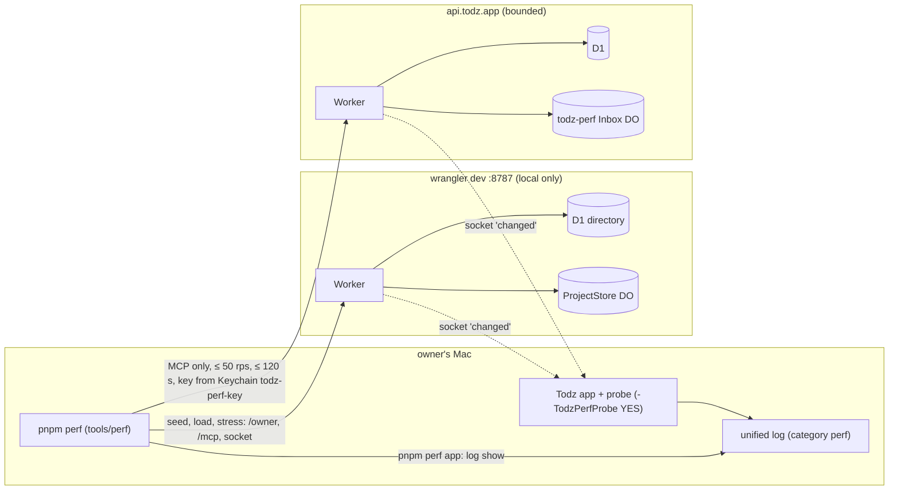

# Performance

**Status:** Approved
**Tier:** 🟡
**Owner approval:** approved 2026-11-25 by the owner's request to the loop, `todz-loop/PROMPT.md` "Performance" ("tem que ser performático.. então stress e load test, fix it"): budgets first, as an ADR (API and MCP tool calls p95 under 150 ms and p99 under 400 ms at the target load with zero 5xx; the change feed reaching another device in under 1 s; the macOS app's cold launch under 1 s, smooth scrolling with 5,000 tasks, steady memory over a long session, the menu bar and widget refreshing without blocking; the landing's Core Web Vitals green on a phone profile); a pinned dev-dependency tool or a TypeScript script behind `pnpm perf` with scenarios for MCP list, add and complete, the owner API, the change feed and many projects per owner; stress only locally on `wrangler dev` until it breaks, never production; production only a bounded load, at most about 50 requests a second for at most 2 minutes, on a dedicated `todz-perf` account with its own key, cleaned up after, never on sign-in, waitlist or admin, with the rate limits and Turnstile on; every bottleneck fixed red-first; a light budget regression test in `pnpm verify`; numbers before and after in `docs/runbooks/`; the production smoke walk re-checks the budgets. The shape is the loop's call in [ADR 0061](../../adr/0061-performance-has-written-budgets-a-fetch-based-load-harness-behind-pnpm-perf-and-work-count-budgets-in-verify.md).
**ADRs:** [0061](../../adr/0061-performance-has-written-budgets-a-fetch-based-load-harness-behind-pnpm-perf-and-work-count-budgets-in-verify.md), [0005](../../adr/0005-the-local-gate-runs-what-the-diff-can-break.md), [0008](../../adr/0008-runbooks-live-in-the-repository.md), [0013](../../adr/0013-a-project-is-reached-only-through-the-directory.md), [0016](../../adr/0016-the-mcp-server-runs-on-the-sdk-v2-and-serves-both-protocol-eras.md), [0017](../../adr/0017-a-2025-era-client-is-named-by-a-session-in-the-directory.md), [0027](../../adr/0027-the-app-caches-each-owner-s-data-as-json-files-in-its-own-container-until-it-has-a-team.md), [0044](../../adr/0044-the-wrangler-configuration-is-production-on-api-todz-app-and-development-overrides-it.md), and ADR 0060 from `landing-seo` (the Lighthouse procedure)
**Not changing:** what any route, tool or screen answers or shows; the task rules (order, numbering, history, idempotency); the rate limiters, their thresholds and Turnstile; the sign-in, waitlist and admin routes; the landing's files, which `landing-seo` owns while it is building; the MCP protocol eras and their session rule; the app's cache format on disk (ADR 0027); the deploy runbook's steps; the Workers plan

## Problem

todz has never been measured. Every MCP call and owner request crosses the D1 directory once or twice and then one Durable Object per project, in series. A single `add` or `update` reads every task of its project to find one order key; history and listings run without an index. The app rebuilds its task views on every read and rewrites a project's whole cache file on the main actor for each task it saves. Whether any of this matters at 5,000 tasks or 200 projects is unknown, and nothing stops the next change from making it worse.

## Goals

- The budgets of ADR 0061 § 1 are written, measured before and after, and met; a budget the decision rule cannot meet is recorded with its number and the next candidate.
- `pnpm perf` runs every scenario locally, ramps a stress run locally until it breaks, runs the bounded production run on the `todz-perf` key only, and reads the app's probe.
- Every bottleneck the decision rule (ADR 0061 § 9) selects is fixed red-first.
- `pnpm verify` fails when a change adds a D1 round trip, a Durable Object call or a full scan to a measured path, or when the app builds its task views more than once per change, writes a project file on the main actor, or stops coalescing a burst of saves.
- `docs/runbooks/performance.md` holds the procedures and a dated results table with every before and after row.

## Non-goals

- **Smart Placement, D1 read replicas, a key-lookup cache.** Each moves data or delays a revocation; ADR 0061 → Revisit names them as the next step if production still misses after the fixes here.
- **Deleting the `todz-perf` workspace.** No route deletes a workspace or a task; adding one is a data-deletion feature of its own.
- **The landing's code.** `landing-seo` is building on those files; this feature measures the landing's Core Web Vitals and records them. A miss after `landing-seo` ships becomes a step here only once its branch has merged (plan, step 30).
- **A Workers plan change.** Forbidden to the loop.
- **Field data (real users' Web Vitals).** No analytics beacon runs on the landing; lab numbers stand in.

## Design

### Data flow

- **Local load.** `pnpm perf load` signs in a fresh owner through the fake provider, seeds the hot project (5,000 tasks), the many-projects owner (20 workspaces, 200 projects) and the keys, then runs the target load of ADR 0061 § 2 on an open model for 120 s and prints one row per scenario. `Server-Timing` on each answer splits a slow request between the directory and the project store.
- **Change feed.** A second client holds the hot project's socket. For each write the harness records the send time; on `changed` it pulls `GET …/changes?cursor=<last>` and records when the written task number arrives. The latency is the difference.
- **Stress.** `pnpm perf stress` runs the same mix locally from 50 requests a second, times 1.5 every 30 s, until 5xx passes 1% or p99 passes 2 s, and prints the last step that held and the first that broke.
- **Production.** `pnpm perf production` reads the key from the Keychain (5 s timeout), draws a run identifier, and runs MCP `list`, `add` and `done` (2026-07-28 era) at most 50 a second, at most 50 in flight, under one 120 s timer. The `fetch` it hands the MCP SDK refuses, before sending, anything but `POST https://api.todz.app/mcp`, and follows no redirect. Each added task's title and idempotency key carry the run identifier. Adds stop at 100 s; the tail lists the run's own open tasks by that prefix and completes them. It prints the verdicts with the `Server-Timing` split and the open count of a final filtered list (0), and writes each answered `add`'s task number and send time as JSON lines for the change-feed join. `wrangler tail` during the run gives each request's `cpuTime` and `outcome`.
- **App.** The app launched with `-TodzPerfProbe YES` logs its launch time, the frame intervals of a scripted scroll, its footprint every 30 s and each pulled task number's arrival. `pnpm perf app` reads those lines (`log show`) and, given a production run's JSON lines, joins arrivals to sends.
- **Verify.** Work-count budget tests (round trips, statements, Durable Object calls, rows read, each at or under a named constant) run in the API's `unit` gate; the app's counter tests run in TodzKit's `swift test` inside the `macos` gate. The 8 ms model medians come from a benchmark the runbook runs, printed and recorded, never asserted.

### Interfaces

- **`pnpm perf <command>`** (root script → `pnpm --filter @todz/perf perf`):
  - `load [--target local]`: the target load; exit 1 on any missed budget.
  - `stress`: local only; refuses `--target production`.
  - `seed --tasks <n> --projects <n>`: local only; prints the fake identity to sign the Debug app in with and the hot project's identifier.
  - `soak --minutes <n>`: local only; MCP `update` on 50 fixed tasks round-robin at 1 a second plus `list`, so the data stays the same size.
  - `production`: the bounded run; refuses a rate over 50, a duration over 120 s, a scenario other than MCP, a missing or unreadable Keychain item; on the wire, anything but `POST https://api.todz.app/mcp`, any redirect, a retry after 401, more than 50 in flight, anything after 120 s.
  - `production --cleanup <run>`: only a filtered `list` and `done` for that run's tasks, at most 50 a second for at most 60 s.
  - `app [--sends <file>]`: reads the probe's lines since the last launch and checks them against the budgets.
  - `tail <file>`: reads a saved `wrangler tail --format json` window and reports the count per `outcome` and the p50 and p99 of `cpuTime`.
- **`PerfTarget`** (enum): `local` → `http://localhost:8787`, `production` → `https://api.todz.app`. No other origin is accepted.
- **Budgets** (`tools/perf/src/budgets.ts`): the numbers of ADR 0061 § 1 as named constants, the only place the harness reads them.
- **Report row:** `scenario | requests | rate/s | p50 ms | p95 ms | p99 ms | max ms | 5xx | directory ms | project ms | verdict`, one per scenario (the last two the medians of `Server-Timing`, empty when no answer carried it), and `open tasks left: <n>` from a final filtered list after a production run.
- **Run identifier:** each production run's added tasks are titled `todz-perf <run> #<slot>` with the idempotency key `todz-perf-<run>-<slot>`; cleanup touches nothing else.
- **`Server-Timing`** on `/mcp` and `/owner` answers that reached a handler: `directory;dur=<ms>, project;dur=<ms>` (summed per store over the request). A streamed MCP answer is read to its end before the header is set, bytes unchanged.
- **Probe switch:** on only when `ProcessInfo.processInfo.arguments` holds `-TodzPerfProbe YES` (the scroll walk also `-TodzPerfScroll YES`); `UserDefaults` is never read for it; off, the app starts no timer, display link or observer.
- **Probe lines** (subsystem the app's bundle identifier, category `perf`, integers only, each logged `.public`, never an identifier, a title or a token):
  - `launch-ready ms=<int>`: process start to the first task rows on screen, once per launch;
  - `scroll frames=<int> over-budget=<int> worst-ms=<int> refresh-ms=<int>`: after the scripted scroll;
  - `footprint mb=<int>`: every 30 s;
  - `task-arrived number=<int> at-ms=<epoch ms>`: when a pull puts a task of the project the window shows in the board.
- **Keychain item:** service `todz-perf-key`, account `todz`, the MCP key of the `todz-perf` workspace's Inbox; created by the owner with `security add-generic-password -U -s todz-perf-key -a todz -T /usr/bin/security -w`, so `security` reads it without an approval dialog, and deleted by the owner.

### Failure handling

- A missed budget prints `FAIL` on its row and exits 1; the runbook's `If it fails` line says where to look (the `Server-Timing` split, the stress step that broke).
- A production run that hits a 5xx keeps going to its end (stopping early would hide the count) but never retries and never exceeds its plan; a 429, a 3xx, a network error or a request the wire guard refused counts as a failure on its row; a slot that finds 50 requests in flight is recorded `dropped`; at 120 s the timer aborts whatever is still in flight.
- A production run whose final filtered list still shows its own tasks open prints that count; the runbook's step completes them with a cleanup-only invocation (`production --cleanup <run>`), which lists by the run's prefix and calls only `done`. A task without the run's prefix is never completed.
- The harness never prints the key, never writes it to a file and never passes it on a command line; a Keychain read that fails or passes 5 s stops the run before any request.
- The probe is off by default; with it on, a log failure is ignored (the unified log is best-effort), never a crash.
- A Durable Object schema change (version 3, indexes only) is additive: code rolled back to version 2 runs on a version-3 store unchanged.

## Open questions → answers

| Question | Options | Owner's answer | Date |
|----------|---------|----------------|------|
| Load tool | `autocannon` pinned; k6; a TypeScript harness with `fetch` and the MCP SDK | The loop's call: the TypeScript harness, no new package (ADR 0061 § 3) | 2026-11-25 |
| The `todz-perf` account | A loop-made owner (needs a mailbox); the owner's session; an MCP key in a `todz-perf` workspace | The loop's call: the MCP key, owner-issued, in the Keychain with `security` pre-authorized; the run touches only tasks carrying its own identifier; the owner API and change feed in production are checked in the smoke walk with the owner's app (ADR 0061 § 5, § 7) | 2026-11-25 |
| App launch and scrolling | XCTest UI metrics; signposts in Instruments; a probe plus model benchmarks | The loop's call: a probe off by default plus TodzKit benchmarks (ADR 0061 § 7) | 2026-11-25 |
| The regression check in verify | Wall-clock ceilings; work counts | The loop's call: work counts for the API and counters for the app, the app's 8 ms medians printed by a benchmark and recorded (ADR 0061 § 8, amended by the plan review, R5 and R12) | 2026-11-25 |
| Where numbers live | A dated learning; a runbook | The loop's call: `docs/runbooks/performance.md` with a results table (ADR 0061 § 10) | 2026-11-25 |

## Test strategy summary

Pure harness logic (percentiles, the open-model schedule, the production caps, the wire guard, the run's cleanup filter, the Keychain timeout, the report, the log and tail parsers, the join) gets Vitest unit tests, red first, the guard and the MCP handshake asserted on the wire. The API's work counts get budget tests in the Workers pool, each at or under a named constant, set first at today's counts and lowered red-first per fix. Each fix also keeps the behaviour tests of its use case green. The app's probe switch, lines and hitch counting get TodzKit unit tests; its model gets deterministic counter tests (views built per read, main-actor writes, coalescing) and a benchmark the runbook runs for the 8 ms medians. The real numbers come from the runbook's runs, recorded before and after; the tester re-runs the local scenarios and the app walk and attacks the claims. Coverage honesty lists what lab numbers cannot prove.
