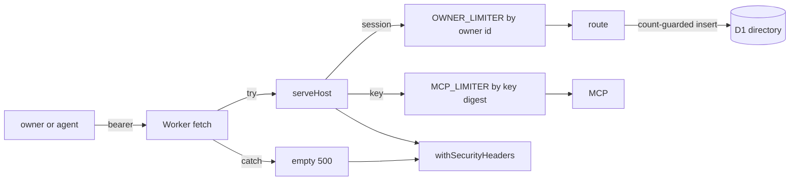

# Security sweep

**Status:** Building
**Tier:** 🔴 (quotas and rate limits on every signed-in route, the change socket's lifetime, the headers of every host, the app's session vault)
**Owner approval:** approved 2026-11-24 by the owner's directive in `todz-loop/PROMPT.md` ("Security": "queremos rate limit e captcha nos endpoints públicos como send magic link; e também já faz varredura pra corrigir brechas de segurança"): a full adversarial review of the whole codebase and the production configuration, every finding fixed red-first with a test in this PR, the result recorded in `docs/runbooks/` or a dated learning
**ADRs:** [0073](../../adr/0073-signed-in-writes-have-quotas-and-signed-in-routes-a-rate-limit-per-owner-and-per-key.md), [0045](../../adr/0045-the-public-sign-in-routes-are-limited-three-ways-and-turnstile-guarded-failing-closed.md), [0050](../../adr/0050-the-waitlist-answers-alike-for-every-address-mails-once-and-is-guarded-like-sign-in.md), [0061](../../adr/0061-performance-has-written-budgets-a-fetch-based-load-harness-behind-pnpm-perf-and-work-count-budgets-in-verify.md)
**Not changing:** the sign-in token format, its one-use rule and its expiry; the public routes' limiters, Turnstile and their fail-closed rule (ADR 0045); the MCP key format and its digest at rest (ADR 0019); the owner session lifetime (ADR 0021); the key on the agent's shell command line (ADR 0034, finding 13 accepted)

## Problem

The sweep of `main` at `e10641e` found one IMPORTANT and twelve MINOR findings; `pnpm security:audit` (production, high) is clean, the full `pnpm audit` shows four dev-only highs.

| # | Severity | Where | Finding |
|---|----------|-------|---------|
| 1 | IMPORTANT | `owner-endpoint.ts`, `mcp-endpoint.ts`, `directory-workspaces.ts`, `project-keys.ts` | A signed-in owner can create workspaces, projects and keys without limit, and call every signed-in or MCP route without a rate limit, filling the one shared D1 directory every tenant reads |
| 2 | MINOR | `owner-request.ts` | `parsedBody` and `parsedPublicBody` read a body of any size, the public one before Turnstile |
| 3 | MINOR | `public/_headers` | Static assets carry no `Content-Security-Policy` or `frame-ancestors` |
| 4 | MINOR | `email-address.ts` | The domain part admits `?`, `#` and `%` |
| 5 | MINOR | `index.ts` | An exception in `serveHost` skips `withSecurityHeaders` |
| 6 | MINOR | `site/waitlist-store.ts` | The waitlist has no daily row cap |
| 7 | MINOR | `FileSessionVault.swift` | `bind` treats any non-empty content as the session secret |
| 8 | MINOR | `AppModel+Server.swift` | The vault migration binds to whatever the default server is |
| 9 | MINOR | `AppModel.swift` | `openLaunchSession` uses its second read without checking the stored origin |
| 10 | MINOR | `project-store.ts`, `owner-changes.ts` | A change socket outlives the sign-out of the session that opened it |
| 11 | MINOR | `apps/docs/package.json` | Four dev-only highs in the `mint` tree (sharp, js-yaml) |
| 12 | MINOR | `http-header.ts` | `Strict-Transport-Security` has no `includeSubDomains` |
| 13 | accepted | `AgentCommand.swift` | The key sits on a shell command line (ADR 0034) |

## Goals

- Every finding 1–12 fixed red-first, each with a test that fails before the fix and passes after it; a test green on arrival is labelled a pin.
- Finding 1 bounds what one owner can write to the shared directory and how fast, per ADR 0073.
- The sweep's result is recorded in a dated learning.

## Non-goals

- New public routes, a new sign-in method, or changing any public route's guard.
- Deleting existing rows over a cap: an owner already above a cap keeps what they have and cannot add more.
- A quota on tasks inside a project: tasks live in the project's own Durable Object, not the shared directory.

## Design

### Server (`apps/api`)

1. **Quotas and rate limits (ADR 0073).** Workspaces per owner, projects per workspace (the Inbox counts) and live keys per project are capped by count-guarded inserts (`INSERT … SELECT … WHERE (SELECT count(*) …) < ?`), the pattern of `insertSignInLinkWithinLimit`. Over a cap the route answers 409 `{"error":"limit_reached"}` and writes nothing. Every signed-in owner route takes `OWNER_LIMITER` keyed by the owner id, and `/mcp` takes `MCP_LIMITER` keyed by the key digest, both after the credential resolves; a refusal answers 429 with `Retry-After`. The caps and limits live in `libs/types`.
2. **Bounded bodies.** `parsedBody` returns `null` unless `isBoundedRequest`, so every owner body, public or signed-in, is refused with 400 `invalid_request` above 4096 bytes or without `Content-Length`, before Turnstile.
3. **Static asset policy.** `_headers` gives `/*` `Content-Security-Policy: default-src 'none'; frame-ancestors 'none'`; `/icon.svg` detaches it with `! Content-Security-Policy` before its own policy.
4. **Address domain.** The domain part matches `^[a-z0-9-]+(\.[a-z0-9-]+)+$`.
5. **Headers on a crash.** `fetch` catches an exception from `serveHost` and answers an empty 500 through `withSecurityHeaders`.
6. **Waitlist daily cap.** The join insert is count-guarded on the rows joined in the last 24 hours; over the cap the join answers "opens soon" and sends nothing.
10. **Sockets end with their session.** Each change socket is tagged with its session digest; signing out closes the tagged sockets in every project the owner has.
11. **Dev-only highs.** `mint` is bumped, or a pnpm override scoped to its tree lifts `sharp` and `js-yaml` to patched versions; `pnpm audit --audit-level=high` exits 0.
12. **HSTS on subdomains.** `includeSubDomains` joins `Strict-Transport-Security` in the Worker and `_headers`, after `http://docs.todz.app`, `http://api.todz.app` and `http://www.todz.app` were each seen answering 301 to `https` on 2026-11-25.

### App (`apps/macos`)

7. `FileSessionVault.bind` accepts only `^[A-Za-z0-9_-]{43}$` after trimming one trailing newline; anything else throws `.unreadable` and leaves the file unchanged.
8. The vault migration binds only to an `https` non-loopback default server; otherwise it erases the file.
9. `openLaunchSession` compares the second read's `stored.origin` with the server URL's origin; a mismatch erases the vault and signs out without a request.

### Data flow

### Interfaces

- `OwnerErrorCode.LimitReached` = `limit_reached`, 409. `OwnerErrorCode.RateLimited` = `rate_limited`, 429 with `Retry-After`.
- `wrangler.jsonc` gains `OWNER_LIMITER` (namespace 8611) and `MCP_LIMITER` (namespace 8612); `feat/day-email` takes 8610.

### Failure handling

- A limiter that is missing or throws on a signed-in route serves the request (ADR 0073 §3): the quotas are the hard bound, the limiter the soft one.
- An exception anywhere in `serveHost` answers 500 with an empty body and the four headers; no stack or message reaches the client.

## Open questions → answers

| Question | Options | Owner's answer | Date |
|----------|---------|----------------|------|
| The caps and the limits | see ADR 0073 | the loop's call, recorded in ADR 0073 for the owner to overturn | 2026-11-25 |

## Test strategy summary

Each finding has its own red test in `apps/api/test` (Vitest on the Workers pool), `tools/repository-shape` for `_headers` and `wrangler.jsonc`, and TodzKit tests for 7–9; `pnpm audit --audit-level=high` for 11.
