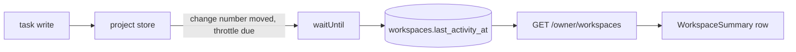

# Sign-in polish

**Status:** In review
**Tier:** 🟡 (a schema change and a write on the task path, two lines of app copy)
**Owner approval:** inherited from [`docs/product/README.md`](../../product/README.md), approved 2026-11-23; the two items come from the build loop's v1.1 list, run 36
**ADRs:** [0098](../../adr/0098-the-picker-shows-a-workspace-s-last-activity-stamped-from-the-project-store-at-most-once-every-five-minutes-per-project.md), supersedes the last-activity deferral of [0076](../../adr/0076-an-account-with-several-workspaces-and-no-remembered-choice-opens-a-picker-of-names-and-project-counts.md)
**Not changing:** the sign-in screen, the sign-in link format, the session, the picker's phase rules, the Workspace menu

## Problem

1. The workspace picker was specified with a "last activity" line and shipped without it, because the server did not hold one.
2. A sign-in link opened while the owner is already signed in is dropped without a word, so a reused link looks like the app ignored the click.

## Goals

- The directory holds `workspaces.last_activity_at`, stamped from the project store after a task write that moved its change number, at most once every five minutes per project, without waiting on D1.
- The owner API lists `last_activity_at` on every workspace, `null` when nothing was written.
- The picker and the Settings list, which share one row view, show "Active 2 minutes ago", "Active 5 hours ago", "Active yesterday", "Active 4 days ago", or no line when there is no stamp.
- A sign-in link handled while the app is signed in, in any phase but signed out, shows "You're already signed in." as the banner every screen already has, with the existing Dismiss button, and the main window comes forward so the line is seen.

## Non-goals

- The activity of a single project, or any activity history.
- Backfilling a stamp for tasks written before the deploy.
- Replacing an error banner that is already showing with the calm line.

## Design

### Data flow

### Interfaces

- Migration `0012_workspace_last_activity.sql`: `ALTER TABLE workspaces ADD COLUMN last_activity_at INTEGER`.
- `WORKSPACE_ACTIVITY_WRITE_INTERVAL_MS` in `libs/types`; `isActivityWriteDue` in `apps/api/src/workspace-activity.ts`.
- `touchWorkspaceActivity` in `apps/api/src/directory-workspaces.ts`: only moves the stamp forward.
- `Workspace.lastActivityAt: Date?` in TodzKit; `ActivityRecency` decides the wording class; `WorkspacePickerCopy.activity(recency:)` words it.
- `AppBanner.alreadySignedIn`; `AppModel.redeem(signInLink:)` raises it when the phase is not signed out and no other banner shows. `showsIncomingSignInLink` is removed: the window now opens for every sign-in link.

### Failure handling

- A failed stamp never fails the task write; it clears the throttle so the next write retries.
- A project store opened without a name throws, since it cannot find its workspace.
- A server older than this change sends no field: the app decodes `nil` and shows no line. An app older than this change ignores the field.
- A link opened while a sign-in is in flight (signed out) is still ignored as before.

## Open questions → answers

| Question | Options | Owner's answer | Date |
|----------|---------|----------------|------|
| Amend 0076 or write a new ADR | amend in place, supersede | Supersede: the ADR rules never rewrite a record | 2026-11-26 (the loop's call) |
| Where the already-signed-in line shows | new view, existing banner | The existing banner: it is already on the main window, the picker and the popover | 2026-11-26 (the loop's call) |

## Test strategy summary

API Vitest for the throttle decision, the stamp after a write, no stamp after a read, a second stamp after the interval and the listing field; TodzKit tests for the recency classes, the field decoding and the banner decision; the rows and the line rendered offscreen for the PR.
