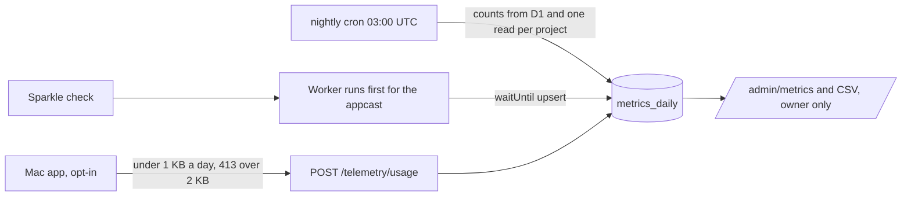

# Telemetry

**Status:** Approved
**Tier:** 🔴 (a schema change, a public write endpoint, a cron, a new Worker path in front of an asset, and what is collected)
**Owner approval:** approved 2026-11-26 by the owner's request ("telemetria sim, mas de forma leve sem estourar meu billing? e onde vou conferir estes números?", recorded in `todz-loop/PROMPT.md` "Telemetry, light and private") and his limits ("payload leve, pra não acumular gigas e eu ter que pagar"); the rest inherits the approval of [`docs/product/README.md`](../../product/README.md) by inheritance.
**ADRs:** [0082](../../adr/0082-telemetry-is-daily-rollups-in-d1-counted-by-a-nightly-cron-the-appcast-and-an-opt-in-app-report-with-no-raw-event-and-self-host-off.md)
**Not changing:** the landing page and its hero, the task hot path, the MCP tools, sign-in, the sync, and any raw log

## Problem

The owner cannot see how many people use todz, which app versions are alive or what agents do, and does not want a third-party script, a new token or product, or a bill that grows with traffic.

## Goals

- Daily rollups only, in one D1 table: one row per day, metric and dimension, with a fixed allow-list of at most about 20 dimension values and a cap of 50 values a day.
- Nightly server aggregates: owners, workspaces, projects, tasks added and completed, agent writes by client, day mails sent.
- Appcast checks counted per app version and macOS major version, from Sparkle's user agent, never storing it.
- An opt-in "Share anonymous usage" switch in the Mac app, off by default, asked once, sending one counts-only rollup a day with an identifier rotated every 30 days.
- `todz.app/admin/metrics`, owner only: 30-day sparklines in inline SVG, totals and a CSV, with no script.
- 13 months of retention, deleted by the cron. A Privacy page in the docs. Self-host off by default.

## Non-goals

- Landing views and download or star clicks: a follow-up commit by another lane, through `incrementMetrics`.
- Any raw event, IP address, user agent, identifier, task content or email in storage.
- A new token, product or third-party script.

## Design

### Data flow

### Interfaces

`metrics_daily (day, metric, dimension, count)`. `POST /telemetry/usage` takes `{ installId, appVersion, macosMajor, counts }` with the five `UsageEvent` names as the only count keys and answers `204`, `413`, `422`, `429` or `503`. `TELEMETRY=on` turns the server side on.

### Failure handling

A refused or missing limiter serves the appcast and counts nothing, and refuses the usage report with `503`. A project that cannot be read fails the nightly run after the rest is written. The admin page closes like the panel when its read fails.

## Open questions → answers

| Question | Options | Owner's answer | Date |
|----------|---------|----------------|------|
| Run the Worker first for the appcast or use Cloudflare's analytics | Worker first; analytics | The loop decides: the Worker runs first for that one path ([ADR 0082](../../adr/0082-telemetry-is-daily-rollups-in-d1-counted-by-a-nightly-cron-the-appcast-and-an-opt-in-app-report-with-no-raw-event-and-self-host-off.md)) | 2026-11-26 |
| Count MCP reads | A D1 write per call; agent writes from history | Agent writes from history: no write on the hot path | 2026-11-26 |

## Test strategy summary

Vitest in `apps/api/test/telemetry/` for the store, caps, retention, no stored identifier or user agent, the nightly run, the appcast, the usage report, the admin page, the CSV and the self-host default; Swift Testing for the switch, the rotation and the counts-only rollup; the Playwright walk of the admin page is the tester's.
