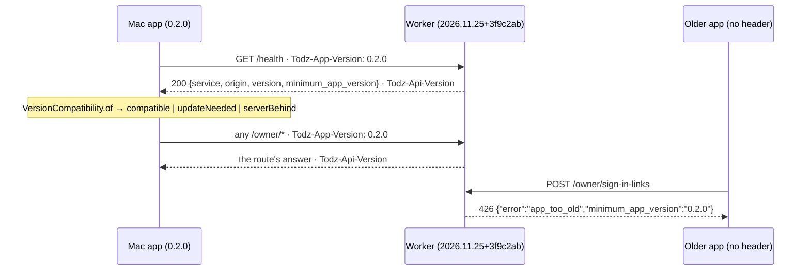

# Version compatibility

**Status:** Shipped 2026-11-25
**Tier:** 🔴 (every owner-API request gains a gate that can refuse the owner's own app; a deploy change; the app's version moves; no schema, no secret, no new entitlement)
**Owner approval:** approved 2026-11-25 by the owner's request to the loop (2026-11-25: "no todz, make sure de mostrar a versão da API vs a versão do app de forma sucinta/curta/friendly, que ambas são compatíveis"), recorded in `todz-loop/PROMPT.md` → "Version compatibility": the API states its version and the oldest app version it accepts on `/health` and in a header on every answer; the app sends its own on every request; one short friendly line in Settings › Server and the sign-in Server disclosure, "App 1.3 · Server 2026.11.25 · ✓ Compatible", a calm "Update todz to keep syncing" with a download link when the app is too old, a note when the server is older than the app expects; a clear refusal instead of a bare 400; one source each, both in the deploy log line and in the Connect an Agent sheet; red-first both sides; deploy the API part. The formats, the routes checked and the refusal are the loop's call in [ADR 0069](../../adr/0069-the-api-states-its-build-version-and-the-oldest-app-it-accepts-and-the-app-shows-one-compatibility-line.md).
**ADRs:** [0069](../../adr/0069-the-api-states-its-build-version-and-the-oldest-app-it-accepts-and-the-app-shows-one-compatibility-line.md), [0058](../../adr/0058-the-app-tells-the-server-its-own-link-scheme-and-the-sign-in-link-carries-it-back.md), [0056](../../adr/0056-the-app-keeps-its-server-url-as-a-setting-and-switching-it-starts-clean.md), [0028](../../adr/0028-the-app-s-task-writes-are-optimistic-and-go-through-a-persisted-outbox.md)
**Not changing:** the MCP endpoint and its tools, the sign-in page and the site, the owner API's routes and bodies, the schema, the session, the server-switch flow (it gains a line, not a step), the outbox's refusal codes, the widgets' behaviour

## Problem

The owner cannot tell which app talks to which server, or whether they still fit. When ADR 0058 made `app_link_scheme` required, his older Release app got a bare `400 invalid_request` on sign-in and showed "Something went wrong with the server", with nothing saying the app was the part to update. Every Mac build is still `0.1.0`, and the Worker has no version at all.

## Goals

- The Worker states its version (`2026.11.25+3f9c2ab`) and the oldest app it accepts (`0.2.0`) on `/health`, and sends `Todz-Api-Version` on every answer it writes.
- The app sends `Todz-App-Version: <its short version>` on every request.
- Any `/owner/*` request from an app that is too old, or sends no version, gets `426` with `{"error":"app_too_old","minimum_app_version":"0.2.0"}` instead of whatever its body would have caused.
- The app shows one line, in Settings › Server, in the sign-in Server disclosure and on the Connect an Agent screen: compatible, update needed (with a Download link), server behind, or the app alone while the server has not answered.
- While signed in, an update-needed app shows a banner with the same words and link, and keeps every queued change for the updated app.
- `server:deploy` stamps the version and prints both versions in its ready line.
- The API part is deployed with the stamp.

## Non-goals

- Auto-update, Sparkle, an in-app installer or a check against a release feed.
- A version check on `/mcp`, `/health`, `/sign-in` or the site.
- A changelog, a "what's new" screen or the build number in the line.
- Reading `Todz-Api-Version` from every answer in the app.
- Refusing a server: a server that is behind is named, never cut off.

## Design

### Data flow

1. **Stamp.** `server:deploy` reads `git log -1` for the deployed commit's UTC date and short hash, builds `YYYY.MM.DD+<hash>`, runs `wrangler deploy --define TODZ_SERVER_VERSION:"<stamp>"`, then prints the ready line with both versions. `wrangler.jsonc` defines `TODZ_SERVER_VERSION` as `null`.
2. **Header.** `index.ts` wraps every answer with `withServerVersion` next to `withSecurityHeaders`: it sets `Todz-Api-Version` when the build is stamped, and leaves a `101` alone.
3. **Health.** `/health` adds `version` (the stamp or `null`) and `minimum_app_version` to its body.
4. **Gate.** `serveOwner` matches the route, then runs `appVersionRefusal(request)` before the public or session dispatch. A missing, malformed or lower `Todz-App-Version` returns the `426`.
5. **App, outgoing.** `OwnerRequest.transportRequest` sets `Todz-App-Version` from `AppVersion.current`, the main bundle's `CFBundleShortVersionString`.
6. **App, incoming.** `health()` decodes `version` and `minimum_app_version` into `ServerVersions`; the model computes `VersionCompatibility` at launch, after every probe and after a server switch. `OwnerErrorBody` maps `app_too_old` with its minimum to `OwnerAPIError.appTooOld(minimum:)`; the model sets `updateNeeded` on the spot.

### Interfaces

| Surface | Before | After |
|---|---|---|
| `GET /health` body | `{"service":"todz","origin":"https://api.todz.app"}` | `{"service":"todz","origin":"https://api.todz.app","version":"2026.11.25+3f9c2ab","minimum_app_version":"0.2.0"}` (`version` is `null` unstamped) |
| Every Worker answer | security headers | + `Todz-Api-Version: 2026.11.25+3f9c2ab` when stamped |
| Every app request | `Authorization`, `Content-Type` | + `Todz-App-Version: 0.2.0` |
| `/owner/*` from a too-old or silent app | the route's answer (today a `400` on sign-in) | `426`, `Cache-Control: no-store`, `{"error":"app_too_old","minimum_app_version":"0.2.0"}` |
| `libs/types` | — | `MINIMUM_APP_VERSION = '0.2.0'`, `API_VERSION_HEADER = 'Todz-Api-Version'`, `APP_VERSION_HEADER = 'Todz-App-Version'` |
| `server:deploy` | `wrangler deploy && tsx scripts/server/cli.ts` | `tsx scripts/server/cli.ts`, which stamps, deploys and prints `todz server ready: https://api.todz.app · server 2026.11.25+3f9c2ab · accepts app 0.2.0 or later  →  paste it in todz › Settings › Server` |
| `apps/macos/project.yml` | `MARKETING_VERSION: "0.1.0"` | `"0.2.0"` for the app and the widgets |
| TodzKit | — | `AppVersion`, `ServerVersions`, `VersionCompatibility`, `minimumServerVersion = "2026.11.25"`, `OwnerAPIError.appTooOld(minimum:)`, `AppBanner.updateNeeded` |

The compatibility rule, in order:

1. A recorded `426 app_too_old` since the last probe, or `appVersion < minimum_app_version` → `updateNeeded`.
2. The server answered with `version: null` or no `version` field → `serverBehind` with the server shown as "older".
3. The server's date part is before `minimumServerVersion` → `serverBehind`.
4. The server answered → `compatible`.
5. The server has not answered, or is unreachable → `serverUnknown`: the app's version alone.

### Failure handling

- **A missing, malformed or lower app version** → `426 app_too_old`; never a `400`, whatever the body.
- **An unstamped build** (local `wrangler dev`, a deploy that skipped `server:deploy`) → no header, `version: null`, the app shows "Server needs an update". The deploy runbook uses `server:deploy` so production is always stamped.
- **`server:deploy` outside a git checkout, or `git` fails** → the script throws `Cannot stamp the server version: <git's error>` before `wrangler deploy` runs; nothing deploys.
- **`wrangler deploy` fails** → the script exits with wrangler's code and prints no ready line.
- **Any `426`**, with a todz body, none or an undecodable one → update required (`appTooOld`, the minimum nil when the body names none): the app pauses sync, keeps its whole queue, counts no attempt and refuses nothing.
- **A queued change answered `app_too_old`** → kept; the outbox stops flushing while the state is `updateNeeded`; the changes go out from the updated app. It never counts as a refusal and never drops a change.
- **The change socket refused** → the socket fails as any refused upgrade does; the next owner call or probe records `updateNeeded`.
- **A server that is behind** → the app keeps working with it; the line names it, nothing is blocked.

## Open questions → answers

| Question | Options | Owner's answer | Date |
|----------|---------|----------------|------|
| Server version format | semver in `package.json`; deploy date; commit date + short hash | the loop's call: commit date + short hash, stamped by a `--define` (ADR 0069 §2) | 2026-11-25 |
| Where the minimum lives | the Worker env; `libs/types` | the loop's call: `MINIMUM_APP_VERSION` in `libs/types` (§3) | 2026-11-25 |
| Which routes check | every route; `/owner/*` and `/mcp`; `/owner/*` only | the loop's call: `/owner/*` only, after the route matches (§7) | 2026-11-25 |
| Status and body | `400` with a code; `426` with a code | the loop's call: `426`, `Cache-Control: no-store`, no `Upgrade` (HTTP/2 forbids it), `{"error":"app_too_old","minimum_app_version":…}` (§7) | 2026-11-25 |
| An app without the header | allow; refuse | the loop's call: refuse, as too old (§7) | 2026-11-25 |
| Header on CORS or preflight | expose it; nothing | the loop's call: the API has no CORS; `OPTIONS` falls to `404` and still carries the header (§4) | 2026-11-25 |
| First app version | keep `0.1.0`; `0.2.0` | the loop's call: `0.2.0`, so every build before the header is older by number too (§1) | 2026-11-25 |
| Download link | a release page; todz.app | the loop's call: `https://todz.app`, the only public page today; the Revisit line of ADR 0069 names the change | 2026-11-25 |

## Test strategy summary

Red-first on both sides. Worker (Vitest in the Workers pool): the header on owner, MCP, health, site and `404` answers, none unstamped; the health body; the gate on every owner route kind (public, session, socket) with no header, a malformed one, a lower one, an equal one and a higher one; `/mcp` and `/health` ungated; the version comparison table; the stamp and the ready line. App (Swift Testing in TodzKit): the request header on an owner call, the probe and the socket request; the health decode with and without versions; `app_too_old` decoded, and a `426` without a body staying unexpected; the compatibility rule's five outcomes; the outbox keeping its changes on `app_too_old`; the banner. Screenshots of compatible, update needed and server behind, light and dark, in Settings, the sign-in disclosure and Connect an Agent. The deploy, the `/health` body and `curl -sSI` on `https://api.todz.app/health` prove the stamp in production.
