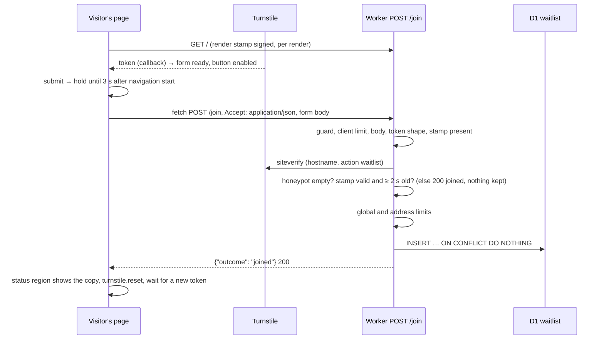

# Waitlist inline

**Status:** Building
**Tier:** 🟡
**Owner approval:** approved 2026-11-25 by the owner's request to the loop, `todz-loop/PROMPT.md` "Waitlist inline" ("waitlist no site tem que ter captcha, se vira e deploy pra prod até o fim.. não queremos spam.. e não precisa recarregar a página pra add na lista"): a visible captcha styled for the Liquid Glass look in light and dark; joining without a reload, with success, already-on-the-list and errors inline in an `aria-live` region; the widget reset after every attempt; the button disabled until a token exists; the no-JavaScript post kept; anti-spam server-side and failing closed (siteverify on hostname and action, the limits per address and per email, a honeypot, a minimum time to submit); the same generic answer for duplicates; tests for the join without navigation, a missing or bad token, the honeypot and a strict CSP; deployed to production and checked there. The shape is the loop's call in [ADR 0067](../../adr/0067-the-waitlist-joins-in-place-over-fetch-behind-a-visible-check-a-honeypot-and-a-signed-render-time.md).
**ADRs:** [0067](../../adr/0067-the-waitlist-joins-in-place-over-fetch-behind-a-visible-check-a-honeypot-and-a-signed-render-time.md), [0050](../../adr/0050-the-waitlist-answers-alike-for-every-address-mails-once-and-is-guarded-like-sign-in.md), [0045](../../adr/0045-the-public-sign-in-routes-are-limited-three-ways-and-turnstile-guarded-failing-closed.md), [0060](../../adr/0060-the-landing-describes-itself-from-the-copy-modules-and-offers-webmcp-tools-over-its-own-turnstile-form.md), [0046](../../adr/0046-the-app-solves-the-challenge-in-a-web-view-and-the-link-page-solves-it-for-the-sign-in.md)
**Not changing:** the `waitlist` table and its migrations; the three limiters, their namespaces and periods; the confirmation mail and the once-per-address claim; the admin and the daily digest; the HTML answer's three notices and their statuses (200, 429, 503); `GET /join`; the sign-in pages and their Turnstile; the landing's sections, layout and other copy; the other three WebMCP tools; the Worker's secrets (no new secret)

## Problem

Joining the todz.app waitlist reloads the page onto `/join#hero`. The Turnstile widget is `interaction-only`, so a visitor sees no human check, and the owner reads the form as unguarded. Scripted posts that obtain a token meet only the limits: there is no honeypot and no minimum time on the page.

## Goals

1. The human check is visible in both forms, in light and dark, inside the glass card, fitting 375 px.
2. A join never navigates: one `fetch` to `POST /join`, the outcome shown inline in the form's `role="status"` region, focus unmoved, the widget reset after every answer.
3. The button is `aria-disabled` until the widget's token exists; a press while waiting posts nothing and says why.
4. The server adds a honeypot and a signed minimum time, both answering the same `joined` as a real join and storing nothing, before siteverify.
5. The answers never reveal whether an address is on the list, and never echo it.
6. Without JavaScript the form still posts and the server answers the HTML page with its notice.
7. `join_waitlist` (WebMCP) waits for the check, submits through the page and answers with the join's outcome.
8. Deployed to production and checked there: the widget renders, a real join lands in the waitlist the admin reads, and a scripted post without a token is refused.

## Non-goals

- A viewport narrower than 375 px: Turnstile's flexible widget needs 300 px.
- A double opt-in, a per-address cooldown beyond the existing limiter, or a reputation score.
- Restyling the inside of the Turnstile iframe (Cloudflare owns it; only its frame, size and theme are ours).
- Letting the no-JavaScript post join: it has no token by construction, so it answers "try again".
- Removing already-stored addresses or the probe row left by the production check.

## Design

### Data flow

### Interfaces

- `POST /join`, body `application/x-www-form-urlencoded` (at most 4 KB, as today): `email`, `cf-turnstile-response`, `stamp`, `todz_fax` (the honeypot).
  - `Accept` naming `application/json` → `application/json` body `{"outcome": "joined" | "invalid" | "check-failed" | "try-again" | "opens-soon"}` with statuses 200, 400, 403, 429 (`Retry-After: 60`), 503, `Cache-Control: no-store`, `X-Content-Type-Options: nosniff`, `Vary: Accept` (ADR 0067 §2).
  - Otherwise → today's landing HTML with its notice, statuses 200, 429 (`Retry-After: 60`), 503, plus `Vary: Accept`.
- `GET /` (site host): each form gains the hidden `stamp` input and the off-screen honeypot; the widget becomes `data-appearance="always"`, `data-size="flexible"`, `data-theme="auto"`; each form has one `role="status"` paragraph holding the note until an answer replaces it.
- `libs/types`: `WAITLIST_MINIMUM_FILL_MS = 2 * MILLISECONDS_PER_SECOND`, `WAITLIST_FILL_HOLD_MS = 3 * MILLISECONDS_PER_SECOND`.
- `apps/api/src/site/waitlist-stamp.ts` (new): `renderStampOf({ secret, renderedAt })` and `stampVerdictOf({ secret, stamp, now })` returning a `StampVerdict` enum (`Patient`, `Missing`, `Forged`, `TooFast`).
- `apps/api/src/site/join-form-markup.ts`: the stamp and honeypot field names, `data-join-state` and its `JoinFormState` enum, the `waitlist-answered` event name, shared by the page script and the WebMCP script.
- `JoinOutcome` enum (in `waitlist-join.ts`): the five outcomes; `LandingNotice` stays the HTML page's enum.
- Copy: `LANDING_COPY.join` gains `waitingForCheck`, `checkFailed`, `invalid`, `unreachable`, `checkError`, `honeypotLabel`; `WEBMCP_COPY.answers` replaces `sent` with one answer per outcome plus `checkTimedOut`.

### Failure handling

| Failure | JSON answer | HTML answer | Kept | Mail |
|---|---|---|---|---|
| Guard incomplete (origin, keys, sender, limiters, client address) | 503 `opens-soon` | 503 opens soon | nothing | none |
| Per-client, global or per-address limit refused | 429 `try-again`, `Retry-After: 60` | 429 try again | nothing | none |
| Body unreadable, wrong media type or bad address | 400 `invalid` | 429 try again | nothing | none |
| Token missing or malformed | 403 `check-failed` | 429 try again | nothing | none |
| Stamp missing (a page from before the deploy) | 403 `check-failed` | 429 try again | nothing | none |
| Honeypot filled, token accepted | 200 `joined` | 200 joined | nothing | none |
| Stamp forged, from the future or younger than 2 s, token accepted | 200 `joined` | 200 joined | nothing | none |
| siteverify refuses (hostname, action, success), whatever the honeypot or stamp hold | 403 `check-failed` | 429 try again | nothing | none |
| siteverify unreachable or our own fault | 503 `opens-soon` | 503 opens soon | nothing | none |
| Store fails | 429 `try-again` | 429 try again | nothing | none |
| Address already on the list | 200 `joined` | 200 joined | unchanged | none |
| New address | 200 `joined` | 200 joined | the row | once |
| Page: fetch rejects or the answer is not the JSON shape | "Couldn't reach todz…" | — | — | — |
| Page: Turnstile script never loads | button stays waiting, "The check couldn't load…" | — | — | — |
| Page: token expires or the widget errors | button back to waiting, the widget refreshes itself | — | — | — |

## Open questions → answers

| Question | Options | Owner's answer | Date |
|----------|---------|----------------|------|
| JSON on the same route or a new one | `Accept` on `POST /join`; a new path | The loop's call: `Accept` on `POST /join` (ADR 0067 §1) | 2026-11-25 |
| How to measure the minimum time | signed render stamp; `challenge_ts`; cookie | The loop's call: a stamp signed with a key derived from the Turnstile secret, 2 s server minimum, 3 s client hold (ADR 0067 §3) | 2026-11-25 |
| A new Worker secret | `WAITLIST_STAMP_SECRET`; HKDF from `TURNSTILE_SECRET_KEY` | The loop's call: no new secret (ADR 0067 §3) | 2026-11-25 |
| What a honeypot or too-fast post answers | an error; the generic `joined` | The owner: the generic answer, nothing stored, no mail | 2026-11-25 |
| Widget size | `normal`; `flexible`; `compact` | The loop's call: `flexible` under the capsule (ADR 0067 §6) | 2026-11-25 |

## Test strategy summary

Red-first unit tests for the stamp, the JSON negotiation, every outcome and the honeypot in `apps/api/test`; the landing markup and the policy in `site-pages.test.ts`; Playwright E2E in `apps/api/e2e/landing.spec.ts` and `landing-seo.spec.ts` for the join without navigation, the honeypot, the too-fast submit, a missing and a bad token, the duplicate, each client state from a fulfilled answer, the no-JavaScript post, the strict policy, light, dark and 375 px, and the WebMCP tool; a Playwright MCP walk on `wrangler dev`; the production check after the deploy. Details in [test-plan.md](test-plan.md).
